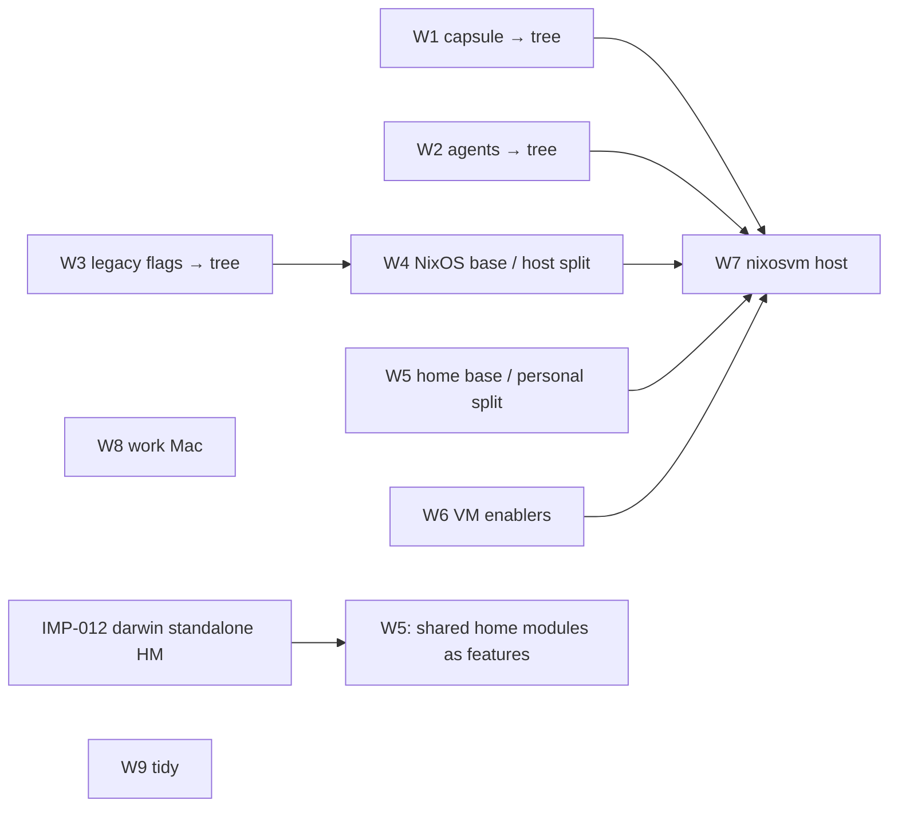

# RFC-001: Multi-host and feature composition roadmap

## Context

This RFC replaces `MULTIHOST.md`: it holds the project goal, the current
state, the target shape, and the order of the remaining work. It decides
nothing. Decisions live in ADR-001..005 and in each slice's design. Order
is fixed here only where a dependency forces it; the rest is left to
design.

**Goal.** Make adding a host cheap. The consumers:

- `nixosvm` (placeholder name): a headless aarch64 NixOS guest under UTM on
  a personal M2 MacBook, used over SSH as a persistent dev environment.
- A work Mac: darwin, no personal tooling, probably M3+ so that the capsule
  can run in a guest there.
- Kept open, not built: x86_64 and aarch64 guests of one role, Lima or
  microvm hosts, and guest-mounted sources (VirtioFS).

Modularity matters as much as the VM. Every slice should leave the repo
easier to extend, even if the VM never lands.

### Where things stand (2026-10-15)

```
flake.nix ──> hosts.nix ── readDir hosts/ ── hosts/<h>/meta.nix (kind, system, home)
                 │
                 ├─ features.nix (resolver, once per host)
                 │     legacy flags ──> specialArgs.features (gate imports)
                 │     feature tree ──> modules.{nixos,homeManager,darwin}
                 │
                 ├─ mkNixos  ──> nixosConfigurations.<h>
                 ├─ mkHome   ──> homeConfigurations."david@<h>"
                 ├─ mkDarwin ──> darwinConfigurations.<h>  (embedded HM gets no projection)
                 └─ coverage ──> flake.coverage (configurations that select otherwise-off features)
```

- **Done under MULTIHOST** (commits `63017d80`, `a7771764`, `2ad1a83e`,
  `aaff9dd2`):
  - S0: the derivation-identity gate, `just drvs` and `just drvs-sets`.
  - S1: `system` is a parameter, and `aarch64-linux` is in `systems`.
  - S2: host factories, with the host table read from `hosts/*/meta.nix`.
  - S2.1: review fixes.
- **Done under SL-001:** the feature tree, the resolver and its tests,
  snooze and openrgb migrated, and coverage targets. ADR-001..005 accepted.
- **Still legacy flags:** everything in the README's flag table (desktop,
  games, ai, hardware, virt, apps, …).
- **Still flat:** `hosts/Sleipnir/config.nix` interleaves base, desktop,
  hardware and Sleipnir-only modules. `hosts/Sleipnir/home.nix` lists the
  personal home modules: satan*, behaviour, nudge, goad, eca, walker,
  chatgpt and sleipnir-doctor.
- **Smeared across files:**
  - Capsule (oubliette) spans `capsule.nix`, `network.nix` (firewall and
    `capsule-forward` nftables), `security.nix` (a sudo rule) and
    `user.nix` (the `assigner` user). It is a microvm, so it needs KVM.
    In a UTM guest that means nested virtualisation, which needs M3+ and
    macOS 15+, so on the M2 it is off.
  - Jailed agents span the agents overlay (system and home pkgs),
    `registry.agents` in `nix.nix`, `eca.nix` and `chatgpt.nix`.
- **Local-path inputs** (panopticon, satan-patcher, satan-attrd, goad,
  oubliette) exist only on Sleipnir. Inputs are fetched lazily, so a
  configuration that never reaches them still evaluates elsewhere. The VM
  must not reach them.

## Discussion

### Target shape

```
features/
  default.nix                areas, in projection order
  <area>/default.nix         features, in projection order
  <area>/<name>/…            descriptor + nixos / homeManager / darwin halves
  profiles/                  outer profiles: mkDefault selections
    workstation.nix          Sleipnir's role (snooze, desktop, …)
    personal.nix             satan*, behaviour, nudge, goad, alarm, …
    headless.nix             what nixosvm takes

hosts/<h>/
  meta.nix                   kind, system, home (validated: IMP-010)
  features.nix               imports profiles, overrides selections
  config.nix                 base + hardware + host-only bits
  home.nix                   home base + host-only bits

legacy flags                 gone; modules/features.nix retired
```

- **"Profile" means an outer profile in `features/profiles/`**: a module
  that selects features. MULTIHOST's `profiles/nixos-base.nix` etc. were
  import bundles. That concept needs a different name: the *base*.
- The **base** is what every host of a kind imports unconditionally (nix,
  user, ssh, network base, cli, …). It is not optional, so it is not a
  feature. Its shape (one import list per kind, or something else) is a
  design question for W4/W5.
- **Every optional module becomes a feature.** Once all flags have moved,
  `specialArgs.features` and `modules/features.nix` go away. Tree features
  already default to off, so MULTIHOST S7 ("invert defaults") happens by
  migration rather than as its own step.
- **Personal is a profile**, not a flag. A host without it never reaches
  the local-path inputs.

### Working rules

These carry over from MULTIHOST. The details live in memories:

| rule | memory |
|---|---|
| Refactors keep derivations identical: snapshot `just drvs` before, diff after, prove ordering-only diffs with `drvs-sets` / `nix-diff` | `mem.pattern.flakes.drv-gate` |
| Moving an import reorders merged lists (reversed breadth-first); make semantic order explicit with `mkBefore` / `mkAfter` | `mem.fact.nix.merge-order` |
| New files are invisible to Nix until `git add -N` | `mem.fact.flakes.git-add-n` |
| `nix fmt` re-locks `emacs/emacs-overlay`; don't commit that drift | `mem.fact.flakes.fmt-relock` (CHR-008) |

Also:

- aarch64 hosts are evaluation-only: the `drvPath` must resolve, and
  nothing is built.
- Take the baseline and the after-snapshot close together. Concurrent
  user edits and the re-resolved `emacs-overlay` both move home and darwin.
- Never `git stash`, `checkout` or `clean`, because `~` is the work tree.
  Commit explicit paths only.

### Workstreams

Each workstream is one or more slices. Order is fixed only where an arrow
shows it.



| # | workstream | covers | notes |
|---|---|---|---|
| W1 | **Capsule → tree** | MULTIHOST S3, IMP-003 (its groups) | The first multi-file feature, and the first real ADR-004 case: its network and sudo pieces are selection-dependent integrations. The resolver has no composition-file slot yet (ADR-004 D2–D3). It needs a platform answer (QUE-001): Linux-only, and off on the M2. |
| W2 | **Agents → tree** | MULTIHOST S6 | The overlay is chosen before evaluation, so the factories read the selection (ADR-001 allows this). `registry.agents` splits out of `nix.nix`. Decide eca and chatgpt: agents or personal. `drvs` already pins the registry only where it exists. |
| W3 | **Legacy flags → tree**, by area | MULTIHOST S7, IMP-006 | Mostly mechanical, with the gate deciding. One slice per area or several at once. Desktop (sway, niri, cosmic, kde, mango) touches CPT-001, ISS-001 and IMP-005, which may make it a slice of its own. Ends by retiring `modules/features.nix` and `specialArgs.features`. |
| W4 | **NixOS base / host split** | MULTIHOST S4, IMP-004 | Classify each `modules/nixos/*.nix` as base, a feature (desktop and others), Sleipnir hardware, or Sleipnir-only. Split mixed modules (`programs`, `1password`, `network`'s `enp8s0` profile). Expect ordering-only diffs. |
| W5 | **Home base / personal split** | MULTIHOST S5 | Linux home base vs desktop features vs the `personal` profile. Shared home modules (`modules/home/shared`) cannot become features until IMP-012 (RV-001 F-3); until then they stay in the base. |
| W6 | **VM enablers** | CHR-002, ISS-003, IMP-009, IMP-010 | Independent of the tree. Can go at any time before W7. |
| W7 | **nixosvm host** | MULTIHOST S8, QUE-004 | aarch64-linux. Hand-written `hardware.nix` (qemu-guest, filesystems by label, virtio initrd), DHCP. **DNS is open** (ControlD as on Sleipnir, or a work setup): ask. Selects `headless` + agents, not capsule. Exit: `just drvs` shows its system and home; the real install is the user's. |
| W8 | **Work Mac** | IMP-011, ISS-004, IMP-012 | Username per host, darwin overlay ownership, standalone HM. Waits for the machine. |
| W9 | **Tidy** | CHR-003, CHR-004, CHR-006, CHR-007, MULTIHOST S9 | Opportunistic. `alarm.nix` device ← `hostname`; per-host overlays → their modules; `sleipnir-doctor` naming. |

### Considered and not adopted: srid/nixos-unified (2026-10-09)

Its `mk*` wrappers fix specialArgs to `{ flake = …; }`. They embed HM in
NixOS (we keep standalone HM: ADR-003), and its autowiring re-exports every
module. Taken from it: the host table read from `hosts/*/`. **Revisit its
`activate`** when deploying from Sleipnir to the VM matters. Its remote
mode copies the flake and overridden inputs to the target and builds there,
which avoids cross-building x86 → aarch64. It reads
`config.nixos-unified.*`, so check whether it works on its own. Until then,
run `just` inside the guest.

## Outcome

Open. This RFC stays open as the living roadmap: update the workstream
table as slices land, and settle it when W7 lands or the goal changes.

Open questions that shape the workstreams:

- QUE-001: how a feature declares its platform scope (W1, W3, W7).
- QUE-004: the shape of the Mac-hosted VM (W7).
- How the base is expressed (W4, W5).
- Where ADR-004's selection-dependent integrations live (W1, the first case).
- HYP-001 (the resolver suffices) is still `proposed`. SL-001's results
  support it. W1 is its next real test.

## References

- ADR-001..005 (composition direction); SL-001 (pilot); HYP-001; EVD-001.
- QUE-001, QUE-004; CPT-001.
- Backlog: CHR-002..004, CHR-006..008, IMP-003, IMP-004, IMP-006, IMP-009..012, ISS-001, ISS-003, ISS-004.
- `MULTIHOST.md` up to its retirement commit (git history): S0–S2.1 notes, accepted ordering diffs, baselines.
  ADR-001, ADR-002 and ADR-003 still cite it in their References; repoint
  them to this RFC in a later revision.
