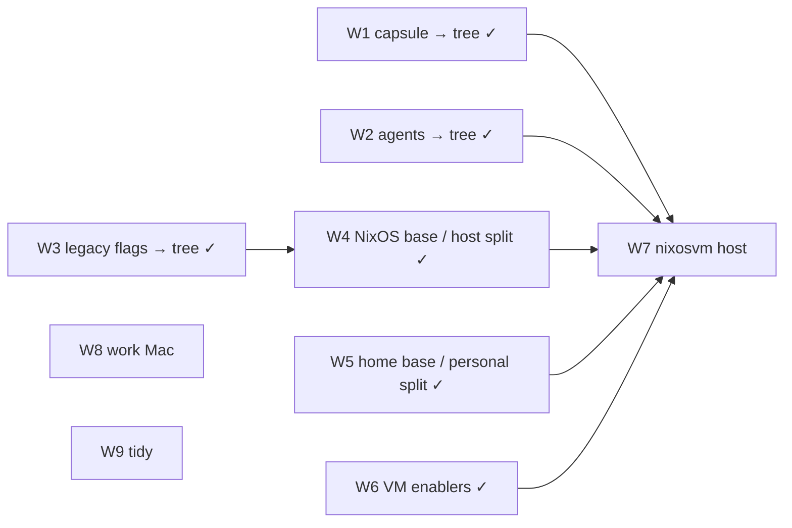

# RFC-001: Multi-host and feature composition roadmap

## Context

This RFC replaces `MULTIHOST.md`: it holds the project goal, the current
state, the target shape, and the order of the remaining work. It decides
nothing. Decisions live in ADR-001..005 and in each slice's design. Order
is fixed here only where a dependency forces it; the rest is left to
design.

**Goal.** Make adding a host cheap. The consumers:

- `nixosvm` (placeholder name): a headless aarch64 NixOS guest under UTM on
  a personal M2 MacBook, used over SSH as a persistent dev environment.
- A work Mac: darwin, no personal tooling, probably M3+ so that the capsule
  can run in a guest there.
- Kept open, not built: x86_64 and aarch64 guests of one role, Lima or
  microvm hosts, and guest-mounted sources (VirtioFS).

Modularity matters as much as the VM. Every slice should leave the repo
easier to extend, even if the VM never lands.

### Where things stand (2026-10-17)

```
flake.nix ──> hosts.nix ── readDir hosts/ ── hosts/<h>/meta.nix (kind, system, home)
                 │
                 ├─ features.nix (resolver, once per host)
                 │     feature tree ──> modules.{nixos,homeManager,darwin}
                 │
                 ├─ mkNixos  ──> nixosConfigurations.<h>
                 ├─ mkHome   ──> homeConfigurations."david@<h>"
                 ├─ mkDarwin ──> darwinConfigurations.<h>
                 └─ coverage ──> flake.coverage (configurations that select otherwise-off features)
```

- **Done under MULTIHOST** (commits `63017d80`, `a7771764`, `2ad1a83e`,
  `aaff9dd2`):
  - S0: the derivation-identity gate, `just drvs` and `just drvs-sets`.
  - S1: `system` is a parameter, and `aarch64-linux` is in `systems`.
  - S2: host factories, with the host table read from `hosts/*/meta.nix`.
  - S2.1: review fixes.
- **Done under SL-001:** the feature tree, the resolver and its tests,
  snooze and openrgb migrated, and coverage targets. ADR-001..005 accepted.
- **Done under SL-004:** standalone darwin home (Draupnir, IMP-012); factories
  pass identity plus one injected module and evaluators build pkgs (DEC-016,
  ISS-004, IMP-009, CHR-003); drvs gate covers every output (CHR-004).
- **Done under SL-002:** capsule onto the tree (W1).
- **Done under SL-003:** the feature shape is area files of self-named
  features (DEC-015; ADR-002 revised by REV-002).
- **Done under SL-005 and SL-006:** every legacy flag is a tree feature
  (W3). Hardware went to machine config, `hosts/<h>/machine.nix` (DEC-019).
  `modules/features.nix` and `specialArgs.features` are gone; the resolver
  keeps an outer-option-at-feature-path check (DEC-025). `just probe`
  extends the gate to packages, groups and link maps.
- **Done under SL-007:** the NixOS side is classified (W4). The base is
  `modules/nixos/default.nix`, an import list every NixOS host imports
  (DEC-027); `modules/nixos/` holds only it, its imports and two parked
  files. Sleipnir's parts are in `machine.nix`, its site, account and tuning
  beside `config.nix` (`dns.nix`, `oom.nix`; DEC-028, DEC-029). The rest are
  features: `desktop.{core,greeter}`, the `compositor` and `shell` areas,
  `audio.pipewire`, `hardware.{bluetooth,qmk,tablet,logitech}`,
  `services.postgresql`. `coverage."base@aarch64-linux"` evaluates the base
  alone on aarch64. A big record may import its own modules (ADR-002 D3,
  REV-006).
- **Done under SL-008:** the home side is classified (W5). The home base is
  `modules/home/default.nix` (DEC-031), imported through a platform layer
  (`modules/home/{linux,darwin}`) by each host's `home.nix`; desktop, cli and
  editor packages are features by function, and the personal ones (satan*,
  behaviour, nudge, goad, walker, the doctor's checks) sit behind the
  `personal`, `personal-linux` and `personal-darwin` profiles (DEC-033).
  Records carry `platforms`, enforced by the resolver (DEC-030); cli packages
  filter by `availableOn` minus `features/cli-broken.nix` (DEC-036), so
  Draupnir gains the portable cli set. `coverage."home@aarch64-linux"` and
  `just isolation` (local-path inputs stubbed) guard the headless home.
  `config.nix` still holds Sleipnir's overlays (W9).
- **Done under SL-009:** W2 and W6.
  - The agents overlay applies only to legacyPackages (DEC-040).
  - `features/agents.nix` holds `registry`, `eca` and `chatgpt`, selected by
    `personal-linux` (DEC-041).
  - Every input is declared by its remote URL, and the lock holds no local
    source; `just test` guards that (DEC-038, ISS-006).
  - `bin/dev-checkouts` overrides only the checkouts present under `~/dev`
    (DEC-037, ISS-003).
  - `hosts/<h>/meta.nix` is validated before resolution (DEC-039, IMP-010).
- **Done under SL-010** (W9, part): the bases hold only what every host needs
  (DEC-042). Optional pieces became nixos halves of existing features, or new
  records: `virt.sandbox`, `net.tailscale`, `services.{avahi,ssh}`,
  `files.locate`, `terminal.zsh` (DEC-042, DEC-044). Root's shell is bash.
  Parked modules (hyprland, kmscon, shpool) live in `parked/` (DEC-043); dead
  files are deleted. `coverage."base@aarch64-linux"` and
  `coverage."home@aarch64-linux"` shrank.
- **Dev checkouts** (panopticon, satan-patcher, satan-attrd, goad,
  oubliette) exist only on Sleipnir. Elsewhere those inputs come from the lock
  (GitHub). Inputs are fetched lazily, so a configuration that never reaches
  them evaluates without fetching them. The VM must not reach them:
  `just isolation` stubs them for the lean homes. (Capsule needs KVM: in a UTM
  guest that means nested virtualisation, M3+ and macOS 15+, so it is off on
  the M2.)

## Discussion

### Target shape

```
features/
  default.nix                {lib}: areas, in projection order ({ name; value; } pairs)
  <area>.nix                 self-named features, in projection order
  <area>/<name>.nix          a feature big enough for its own file, all halves
  <area>/<name>/             modules that record imports, its alone (ADR-002 D3)
  <area>/…                   assets, beside their feature
  profiles/                  outer profiles: mkDefault selections
    workstation.nix          Sleipnir's role (snooze, desktop, …)
    personal.nix             portable: editors, every cli feature (DEC-033, SL-008)
    personal-linux.nix       personal + satan*, attention.* (Linux-only records)
    personal-darwin.nix      personal + Mac-only (nothing yet; IMP-023)
    headless.nix             what nixosvm takes (W7)

hosts/<h>/
  meta.nix                   kind, system, home (validated: IMP-010)
  features.nix               imports profiles, overrides selections
  config.nix                 imports the base, then host config (DEC-028)
  <name>.nix                 host config too large for config.nix (dns, oom)
  machine.nix                machine config: bound to this host's parts (DEC-019)
  home.nix                   one home layer + identity, stateVersion, host-only bits

modules/nixos/default.nix    the NixOS base: an import list, no switch (DEC-027, SL-007)
modules/home/default.nix     the home base, an import list (DEC-031, SL-008)
modules/home/{linux,darwin}/ platform layers over it; a host imports one
parked/                      parked modules: never imported (DEC-043)

legacy flags                 gone; modules/features.nix retired (done, SL-006)
```

- **"Profile" means an outer profile in `features/profiles/`**: a module
  that selects features. MULTIHOST's `profiles/nixos-base.nix` etc. were
  import bundles. That concept needs a different name: the *base*.
- The **base** is what every host of a kind imports unconditionally (nix,
  user, network base, cli inspection set, …; DEC-042). It is not optional, so it is not a
  feature. For NixOS it is one import list, `modules/nixos/default.nix`
  (DEC-027, SL-007). For home it is `modules/home/default.nix` plus a
  `linux/` or `darwin/` layer, one imported by each `hosts/<h>/home.nix`
  (DEC-031, SL-008).
- **Every optional module becomes a feature.** The flags, `specialArgs.features`
  and `modules/features.nix` are gone (SL-006). Tree features default to off,
  so MULTIHOST S7 ("invert defaults") happened by migration.
- **Personal is a profile**, not a flag. A host without it never reaches
  the local-path inputs.

### Working rules

These carry over from MULTIHOST. The details live in memories:

| rule | memory |
|---|---|
| Refactors keep derivations identical: snapshot `just drvs` before, diff after, prove ordering-only diffs with `drvs-sets` / `nix-diff` | `mem.pattern.flakes.drv-gate` |
| Moving an import reorders merged lists (reversed breadth-first); make semantic order explicit with `mkBefore` / `mkAfter` | `mem.fact.nix.merge-order` |
| New files are invisible to Nix until `git add -N` | `mem.fact.flakes.git-add-n` |
| `nix fmt` re-locks `emacs/emacs-overlay`; don't commit that drift | `mem.fact.flakes.fmt-relock` (CHR-008) |

Also:

- aarch64 hosts are evaluation-only: the `drvPath` must resolve, and
  nothing is built.
- The probe does not measure `/etc`: compare built `/etc` separately,
  excluding `nix/registry.json` (it carries the flake source path). Changes
  NixOS deduplicates, or to groups that do not exist, leave no build trace;
  check option values.
- Take the baseline and the after-snapshot close together. Concurrent
  user edits and the re-resolved `emacs-overlay` both move home and darwin.
- Never `git stash`, `checkout` or `clean`, because `~` is the work tree.
  Commit explicit paths only.

### Workstreams

Each workstream is one or more slices. Order is fixed only where an arrow
shows it.



| # | workstream | covers | notes |
|---|---|---|---|
| W1 | **Capsule → tree** (done, SL-002) | MULTIHOST S3, IMP-003 (its groups) | The first multi-file feature, and the first real ADR-004 case: its network and sudo pieces are selection-dependent integrations. The resolver has no composition-file slot yet (ADR-004 D2–D3). It needs a platform answer (QUE-001): Linux-only, and off on the M2. |
| W2 | **Agents → tree** (done, SL-009) | MULTIHOST S6 | No selection read: the agents overlay moved to its one consumer, legacyPackages (DEC-040). The `agents` area holds `registry` (nixos), `eca` (Linux) and `chatgpt`, selected by `personal-linux` (DEC-041); the eca/chatgpt exception in Sleipnir's `home.nix` is gone. |
| W3 | **Legacy flags → tree** (done, SL-005, SL-006) | MULTIHOST S7 | SL-005: hardware (→ machine config), virt, app formats. SL-006: games, ai, audio, services, apps, desktop, fonts; `modules/features.nix` and `specialArgs.features` retired. Left open: IMP-006 (lean default selection), IMP-016 (apps taxonomy), ISS-001 / IMP-005 (desktop behaviour, CPT-001), ISS-008, IMP-003 (`jackaudio`), IMP-019 (probe hardening). |
| W4 | **NixOS base / host split** (done, SL-007) | MULTIHOST S4, IMP-004 | Every `modules/nixos/*.nix` classified as base (`modules/nixos/default.nix`, DEC-027), feature, machine config (DEC-019) or host config (DEC-028); mixed modules split. Ordering-only diffs through P5, then one behaviour phase: IMP-004's prune, the Rust kernel patch dropped (`rustByDefault`). Left open: IMP-022 (`oom.nix` per host), IMP-002 (`dns.nix`'s private hostname), CHR-014 (i2c), ISS-008. |
| W5 | **Home base / personal split** (done, SL-008) | MULTIHOST S5 | Home base (DEC-031) vs desktop, cli and editor features vs the personal profiles: `personal`, `personal-linux`, `personal-darwin` (DEC-033). Records gained `platforms`, enforced by the resolver (DEC-030, QUE-001); cli packages filter by `availableOn` minus `features/cli-broken.nix` (DEC-036), so Draupnir imports `personal-darwin`. The headless home stays W7's; `coverage."home@aarch64-linux"` (the base and Linux layer on aarch64, no selection) pre-pays it. Left open: IMP-023 (darwin goad), IMP-026 (lazygit), IMP-027 (clangStdenv / binutils in home), IMP-019 (probe `.manpath`). |
| W6 | **VM enablers** (done, SL-009) | ISS-003, IMP-010, ISS-006 | Dev checkouts are machine data (`bin/dev-checkouts`, DEC-037). Inputs are declared by remote, with a lock guard (DEC-038). `meta.nix` is validated (DEC-039). CHR-002 and IMP-009 were done earlier. Left open: ISS-011 (stale oubliette follows); VH-1, the check on Draupnir. |
| W7 | **nixosvm host** | MULTIHOST S8, QUE-004 | aarch64-linux. Hand-written `machine.nix` (qemu-guest, filesystems by label, virtio initrd), DHCP. **DNS is open** (ControlD as on Sleipnir, or a work setup): ask. Imports the NixOS base, already evaluated on aarch64 (`coverage."base@aarch64-linux"`); Sleipnir's DNS and OOM tuning are host config it does not inherit (IMP-022). Selects `headless` + agents, not capsule; it is used over SSH, so `headless` must select `services.ssh` (a base without it has no sshd, DEC-044) and probably `files.locate`. Exit: `just drvs` shows its system and home; the real install is the user's. |
| W8 | **Work Mac** | IMP-011, ISS-004, IMP-012 | Username per host (IMP-011). Darwin overlay ownership (ISS-004) and standalone HM (IMP-012) done in SL-004. Waits for the machine. |
| W9 | **Tidy** | MULTIHOST S9, CHR-013 | Opportunistic; CHR-003, CHR-004, CHR-006, CHR-007 done. Base tidy done (SL-010: reduced bases, new records, `parked/`; DEC-042..044). Remaining: `alarm.nix` device ← `hostname`; per-host overlays → their modules (Sleipnir's `llama-prism`, `whisper-rocm` → the ai/audio features); `sleipnir-doctor` naming. |

### Considered and not adopted: srid/nixos-unified (2026-10-09)

Its `mk*` wrappers fix specialArgs to `{ flake = …; }`. They embed HM in
NixOS (we keep standalone HM: ADR-003), and its autowiring re-exports every
module. Taken from it: the host table read from `hosts/*/`. **Revisit its
`activate`** when deploying from Sleipnir to the VM matters. Its remote
mode copies the flake and overridden inputs to the target and builds there,
which avoids cross-building x86 → aarch64. It reads
`config.nixos-unified.*`, so check whether it works on its own. Until then,
run `just` inside the guest.

## Outcome

Open. This RFC stays open as the living roadmap: update the workstream
table as slices land, and settle it when W7 lands or the goal changes.

Open questions that shape the workstreams:

- QUE-001: how a feature declares its platform scope. Answered by DEC-030
  (SL-008): a `platforms` key on the record.
- QUE-004: the shape of the Mac-hosted VM (W7).
- How the home base is expressed: answered by DEC-031 (SL-008), as the
  NixOS base by DEC-027.
- Where ADR-004's selection-dependent integrations live. W1, W2 and W3 met
  none: W2 scoped the overlay to its consumer instead of choosing it from the
  selection (DEC-040). W7 is the likeliest first case.
- HYP-001 (the resolver suffices) is still `proposed`. SL-001, SL-002,
  SL-005, SL-006, SL-007, SL-008 and SL-009 support it (SL-008 added platform
  scope, a record-level check, not traversal): no migration needed graph traversal
  (SL-007's only new edges are compositors requiring `desktop.core`; SL-009's
  agents area needed no selection read). W7 is its next real test.

## References

- ADR-001..005 (composition direction); SL-001 (pilot); HYP-001; EVD-001;
  DEC-027..029 (base, placement, site DNS); DEC-037..041 (dev checkouts,
  lock, meta validation, overlay scope, agents area);
  DEC-042..044 (bases reduced, `parked/`, ssh and locate as features).
- QUE-001, QUE-004; CPT-001.
- Backlog: CHR-002..004, CHR-006..008, CHR-013, CHR-014, IMP-002, IMP-003, IMP-004, IMP-006, IMP-009..012, IMP-016, IMP-019, IMP-022, ISS-001, ISS-003, ISS-004, ISS-006, ISS-008, ISS-011.
- `MULTIHOST.md` up to its retirement commit (git history): S0–S2.1 notes, accepted ordering diffs, baselines.
  (ADR-001..003 repointed to this RFC, CHR-011.)
