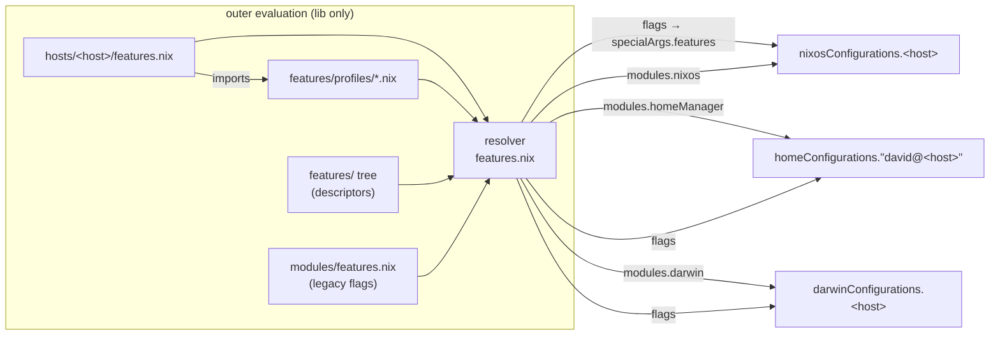
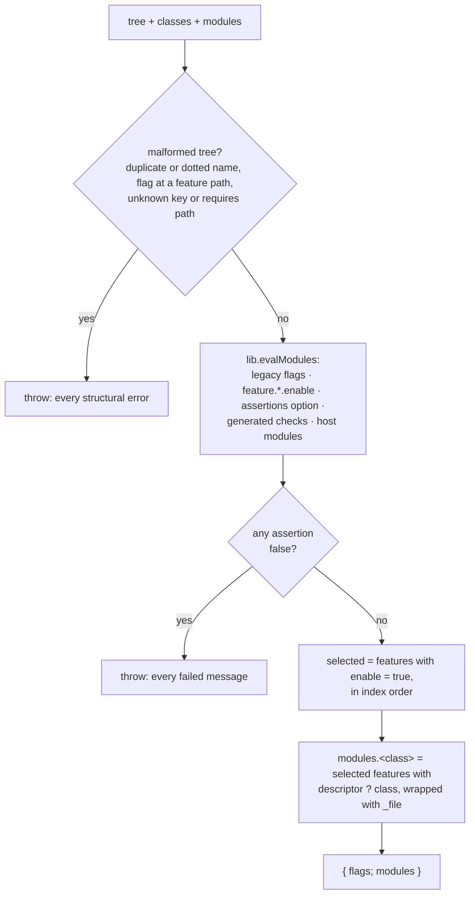
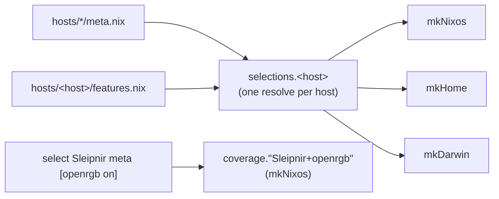

<!-- doctrine:section sec-1 -->
## Overview

### What changes

Today a host chooses its optional modules with boolean **flags**. The flags
are evaluated once, outside every system evaluation, by `features.nix`, and
then passed into NixOS, Home Manager and darwin as the `features`
specialArg. Each host's files read the flags and gate their own imports with
`lib.optional features.x ./x.nix`. The flag table and the import lists are
two things that have to be kept in step by hand, and the two halves of one
feature (system and user) are gated in two different files.

SL-001 adds a second path beside the flags, and moves two features onto it:

- A **feature** is a plain attrset `{ nixos?, homeManager?, darwin? }` whose
  values are ordinary modules. Features live in a **feature tree** under
  `features/`, grouped into **areas**, and are addressed by attribute path
  (`session.snooze`).
- The outer evaluation declares one option per feature,
  `feature.<area>.<name>.enable`, default `false`.
- A **profile** is an outer module that sets those options with `mkDefault`.
  A host imports profiles and can override any of their defaults.
- The resolver checks the final selection (prerequisites, and that every
  selected feature lands somewhere). If a check fails it refuses to return
  anything. Otherwise it **projects** the selected features into one module
  list per class (`nixos`, `homeManager`, `darwin`).
- The host factories in `hosts.nix` append those lists to their `modules`.
  No downstream module reads the new selection.

Snooze (system half plus user half) and openrgb (system only, off on
Sleipnir) move to the new path. Every other feature stays on the flags.

### Why

This is the pilot for ADR-001 to ADR-005. It tests HYP-001's claim that this
small typed resolver, with no dependency graph and no composition library, is
enough for this repo. It also leaves a concrete pattern for later migrations
(MULTIHOST S3–S6).

### The boundary



The diagram shows what each evaluation receives. Selection happens entirely
in the outer evaluation, which uses only `lib`. The three system evaluations
keep their own nixpkgs pins and activation (ADR-003). They receive finished
module lists plus the legacy `flags`, never the new selection. Darwin's
embedded Home Manager receives nothing projected (DEC-001).

### Effective behaviour

Nothing changes for any host. Sleipnir selects snooze through the
`workstation` profile and leaves openrgb off, as today. The Mac selects
neither, so it projects nothing. Today it selects snooze but ignores it.
Every configuration's derivations stay identical.

<!-- doctrine:section sec-2 -->
## Feature tree, descriptors and profiles

### Layout

```
features/
  default.nix                  areas, in projection order
  hardware/
    default.nix                features of the area, in order
    openrgb.nix                nixos half (moved from modules/nixos/openrgb.nix)
  session/
    default.nix
    snooze/
      default.nix              descriptor
      nixos.nix                RTC wake timer   (moved from modules/nixos/snooze.nix)
      home.nix                 bedtime nag      (moved from modules/home/linux/snooze.nix)
      bin/snooze-nag           script           (moved, with its test)
      bin/snooze-nag-test
  profiles/
    workstation.nix            outer profile; not an area
```

The depth is fixed at two levels, `<area>.<name>` (DEC-003). Areas are
ordered `hardware` then `session`, which matches the order of today's gated
NixOS imports (openrgb before snooze). A feature with assets or tests is a
directory. A small one is a single file or an inline value (ADR-002 D3).
Nothing in `features/` is found by listing directories. Every feature is
reached from a written list (ADR-002 D7).

### Index files

Every index is a list of `{ name; value; }` pairs, the shape
`builtins.listToAttrs` takes. The list position is the projection order
(ADR-002 D5).

```nix
# features/default.nix
[
  { name = "hardware"; value = import ./hardware; }
  { name = "session";  value = import ./session; }
]

# features/hardware/default.nix
[
  { name = "openrgb"; value = { nixos = ./openrgb.nix; }; }
]

# features/session/default.nix
[
  { name = "snooze"; value = import ./snooze; }
]
```

### Descriptors

A descriptor is plain data. It is never a module of any evaluator itself
(ADR-002 D1).

```nix
# features/session/snooze/default.nix
{
  nixos = ./nixos.nix;
  homeManager = ./home.nix;
}
```

| key | type | meaning |
|---|---|---|
| `nixos`, `homeManager`, `darwin` | module (path, attrset or function) | the half for that class; absent = this feature contributes nothing there |
| `requires` | list of `"<area>.<name>"` | features that must also be selected (DEC-005) |

No other key is allowed. An unknown key, such as a misspelt class, fails
resolution on every host; otherwise it would drop that half silently.

The resolver may read key names, and may read `requires`. It never imports
or applies a class value (ADR-002 D4). An unselected feature's
modules, and the packages they name, are therefore never evaluated.

Neither snooze nor openrgb has prerequisites. `requires` exists for test 3
and later features.

### Profiles

A profile is an ordinary module of the outer evaluation, and sets only
`mkDefault` values (DEC-004):

```nix
# features/profiles/workstation.nix
{lib, ...}: {
  feature.session.snooze.enable = lib.mkDefault true;
}
```

A host selects profiles by importing them:

```nix
# hosts/Sleipnir/features.nix
{
  imports = [../../features/profiles/workstation.nix];
  games.enable = true;   # legacy flags unchanged
  # …
}
```

- A host may import several profiles, and a profile may import others.
- If profiles disagree at equal priority, evaluation fails. The host
  settles it with a plain definition, which always beats `mkDefault`.
- A profile that selects a feature also selects that feature's
  prerequisites.

### Namespace during coexistence

The legacy flags (`games.enable`, `desktop.sway`, `speech`, …) keep their
top-level names. The new options sit beside them under `feature`, so no path
can be both a boolean flag and a feature (DEC-002). `snooze` and
`hardware.openrgb` are removed from the flags, because they are migrated.

<!-- doctrine:section sec-3 -->
## Resolver

### Contract

```
features.nix : lib → { tree, classes, modules } → { flags, modules }   (or throws)

tree     [ { name = area; value = [ { name; value = descriptor; } … ]; } … ]
classes  the evaluations this host has: [ "nixos" "homeManager" ] | [ "nixos" ] | [ "darwin" ]
modules  outer modules for this host: its features.nix (if any), plus extras such as a coverage override

flags    the legacy flag config; becomes specialArgs.features
modules  { nixos = [ … ]; homeManager = [ … ]; darwin = [ … ]; }
```

Apart from the legacy flag module (`modules/features.nix`), which it always
includes, the resolver is a pure function of its arguments. It does not
find a host's file or the real tree itself; `hosts.nix` passes both in.
Tests can therefore resolve fixture trees without touching `features/`.

### Steps



The flowchart shows the single path through the resolver. It has two
checks, structural then selection, and a failure of either produces no
result at all.

1. **Flatten** the tree into a list of records
   `{ area; name; path = "<area>.<name>"; descriptor; }`, keeping index order.
   Structural checks run first, over every record, selected or not. Any
   failure stops resolution with one message, `feature tree is malformed:`,
   listing every error:
   - a duplicate area or feature path, named (`duplicate feature a.x`);
   - an area or feature name containing `.`. Paths are dot-joined and split
     again to look options up, so a dotted name would otherwise abort the
     evaluation, which `tryEval` cannot catch;
   - a descriptor key other than `nixos`, `homeManager`, `darwin`,
     `requires`;
   - an option declared at a feature's path `<area>.<name>`, such as a
     legacy flag: one concept would have two switches (DEC-002);
   - a path in any `requires` that names no record:
     `unknown feature <r> in <path>.requires`.

   They read only names, descriptor key names, `requires` and option
   declarations, never a class value or a config value, so they stay within
   ADR-002 D4.
2. **Evaluate** the outer modules:
   - `modules/features.nix`, the legacy flags, unchanged apart from the two
     removed flags;
   - the generated options, `feature.<area>.<name>.enable = mkEnableOption …`;
   - an `assertions` option with the NixOS shape:
     `listOf { assertion : bool; message : str; }`;
   - a generated module that adds two kinds of check, below;
   - the host's `modules`, which bring in its profiles.
3. **Checks**, for each feature that is selected in the final merged config:
   - every path in `requires` is selected. Otherwise:
     `feature.<path> requires feature.<r>, which is not selected`;
   - its descriptor has at least one of `classes` (ADR-005 D6, presence test
     only). Otherwise:
     `feature.<path> is selected but has no module for this host's evaluations (<classes>)`.
   Hand-written assertions in any outer module are checked the same way.
   They are the escape hatch for relations that `requires` cannot express.
4. **Enforce.** If any assertion is false, `throw` one message listing all
   failures. The whole result is behind this check, so reading `flags` or
   any `modules.<class>` fails. A home-only build fails exactly like a system
   build (ADR-001 D5). `throw` rather than `abort`, so that tests can catch
   it with `builtins.tryEval`.
5. **Project.** For each class, map the selected records, in order, that have
   that class to `{ _file = "features/<area>/<name>#<class>"; imports = [ descriptor.<class> ]; }`.
   The wrapper records where the module came from, for error messages
   (ADR-002 D6). It treats a path and an inline module the same way.
6. **Return** `{ flags = removeAttrs config [ "feature" "assertions" ]; modules; }`.
   Removing `feature` means no downstream module can read the new selection
   (ADR-001, trailing paragraph).

### Sketch

This shows the intended shape and size, not final code.

```nix
lib: {tree, classes, modules}: let
  inherit (lib) concatMap filter mkEnableOption mkOption types;

  records = concatMap (area:
    map (f: {
      area = area.name;
      inherit (f) name;
      path = "${area.name}.${f.name}";
      descriptor = f.value;
    })
    area.value)
  tree;

  options = {
    options.feature = lib.listToAttrs (map (area: {
        inherit (area) name;
        value = lib.listToAttrs (map (f: {
            inherit (f) name;
            value.enable = mkEnableOption "feature ${area.name}.${f.name}";
          })
          area.value);
      })
      tree);
    options.assertions = mkOption {
      type = types.listOf (types.submodule {
        options.assertion = mkOption {type = types.bool;};
        options.message = mkOption {type = types.str;};
      });
      default = [];
    };
  };

  checks = {config, ...}: let
    enabled = path: lib.getAttrFromPath (lib.splitString "." path ++ ["enable"]) config.feature;
  in {
    assertions = concatMap (r:
      lib.optionals (enabled r.path) (
        map (p: {
          assertion = enabled p;
          message = "feature.${r.path} requires feature.${p}, which is not selected";
        }) (r.descriptor.requires or [])
        ++ [{
          assertion = lib.any (c: r.descriptor ? ${c}) classes;
          message = "feature.${r.path} is selected but has no module for this host's evaluations (${lib.concatStringsSep ", " classes})";
        }]
      ))
    records;
  };

  outer = lib.evalModules {modules = [./modules/features.nix options checks] ++ modules;};
  inherit (outer) config;

  areas = map (a: a.name) tree;
  paths = map (r: r.path) records;
  duplicates = xs: lib.unique (filter (x: lib.count (y: y == x) xs > 1) xs);
  dotted = lib.hasInfix ".";
  structural =
    map (a: "duplicate area ${a}") (duplicates areas)
    ++ map (p: "duplicate feature ${p}") (duplicates paths)
    ++ map (a: "area name \"${a}\" contains \".\"") (filter dotted areas)
    ++ map (r: "feature name \"${r.name}\" in area ${r.area} contains \".\"") (filter (r: dotted r.name) records)
    ++ concatMap (r: let
      bad = lib.subtractLists ["nixos" "homeManager" "darwin" "requires"] (builtins.attrNames r.descriptor);
    in
      lib.optional (bad != []) "unknown descriptor key(s) ${lib.concatStringsSep ", " bad} in feature ${r.path}")
    records
    ++ map (r: "feature ${r.path} is also a flag")
    (filter (r: lib.isOption (lib.attrByPath [r.area r.name] null outer.options)) records)
    ++ concatMap (r:
      map (p: "unknown feature ${p} in ${r.path}.requires")
      (filter (p: !lib.elem p paths) (r.descriptor.requires or [])))
    records;
  bullets = lib.concatMapStrings (m: "- ${m}\n");
  failed = filter (a: !a.assertion) config.assertions;
  selected = filter (r: config.feature.${r.area}.${r.name}.enable) records;
  project = class:
    map (r: {
      _file = "features/${r.area}/${r.name}#${class}";
      imports = [r.descriptor.${class}];
    })
    (filter (r: r.descriptor ? ${class}) selected);
in
  if structural != []
  then throw "feature tree is malformed:\n${bullets structural}"
  else if failed != []
  then throw "feature selection failed:\n${bullets (map (a: a.message) failed)}"
  else {
    flags = removeAttrs config ["feature" "assertions"];
    modules = lib.genAttrs ["nixos" "homeManager" "darwin"] project;
  }
```

### Invariants

- Nothing is selected automatically. Every `enable = true` traces to a
  host or profile definition (DEC-005, HYP-001).
- Projection order is index order. `attrNames` is never used for
  ordering (ADR-002 D5).
- The resolver touches descriptors only through `?`, `requires`, and the
  class value it puts inside `imports`, which the resolver itself never
  forces (ADR-002 D4).
- One record per path (ADR-002 D6). A duplicate area or feature name fails
  resolution before anything else is checked. Otherwise `listToAttrs` would
  silently keep one of the duplicates, while projection emitted both.
- Every `requires` path names a record, whether or not its feature is
  selected. A misspelt prerequisite fails on every host, not only on the
  first host that selects the feature.
- Every descriptor key is one of `nixos`, `homeManager`, `darwin`,
  `requires`, and no area or feature name contains `.`. Like the checks
  above, these fail on every host, selected or not.
- No option is declared at a feature's path, so no concept is both a
  legacy flag and a feature (DEC-002). Namespaces alone would not stop a
  flag `hardware.openrgb` returning beside `feature.hardware.openrgb`.

<!-- doctrine:section sec-4 -->
## Factories and coverage targets

### Current behaviour

`hosts.nix` binds `mkFeatures = import ./features.nix lib`. Each factory
calls `mkFeatures hostname` on its own (`hosts.nix:41`, `:68`, `:99`) and
passes the result as `specialArgs.features` (or `extraSpecialArgs` for
Home Manager). The resolver finds `hosts/<host>/features.nix` by itself.

### Target behaviour

`hosts.nix` resolves each host once and hands the result to every factory
for that host. Each factory takes the selection as an argument, so the
coverage target reuses `mkNixos` unchanged.

```nix
  resolve = import ./features.nix lib;
  tree = import ./features;

  classesOf = meta:
    if meta.kind == "darwin"
    then ["darwin"]
    else ["nixos"] ++ lib.optional (meta.home or false) "homeManager";

  # extra: outer modules beyond the host's own, e.g. a coverage override.
  select = hostname: meta: extra: let
    host = ./hosts/${hostname}/features.nix;
  in
    resolve {
      inherit tree;
      classes = classesOf meta;
      modules = lib.optional (builtins.pathExists host) host ++ extra;
    };

  selections = lib.mapAttrs (hostname: meta: select hostname meta []) hosts;

  mkNixos = hostname: {system, ...}: selection:
    lib.nixosSystem {
      specialArgs = { …; features = selection.flags; };
      modules = [ ./hosts/${hostname}/config.nix {nixpkgs.overlays = …;} ]
        ++ selection.modules.nixos;
    };
  # mkHome:   … extraSpecialArgs.features = selection.flags;
  #           modules = [ home.nix overlay ] ++ selection.modules.homeManager
  # mkDarwin: … specialArgs.features = selection.flags;
  #           modules = [ rev config.nix ] ++ selection.modules.darwin
```

The outputs pass `selections.${hostname}`. Because `selections` is a single
`let` binding, the NixOS and standalone Home Manager configurations of one
host share one resolution, and a failed check stops both (ADR-001 D5).



The diagram shows that every switchable configuration draws on the same
per-host selection. The coverage target is the one place a selection is
built with extra modules.

### Darwin

`mkDarwin` appends `modules.darwin` only. Darwin's embedded Home Manager
(`darwin/default.nix:22-31`) receives no projected modules and still gets no
`features` (DEC-001). A darwin host that selects a feature with only
`nixos` or `homeManager` halves fails the ADR-005 D6 check, instead of
silently doing nothing. IMP-012 tracks making darwin's Home Manager
standalone, which would remove this asymmetry.

This blocks a whole class of later migrations, not only some future feature.
`darwin/home.nix` imports the shared home modules
(`modules/home/shared/{zsh,nvim,nvim-plugins,programs,emacs,cli,nushell}.nix`),
so none of them can become a feature until darwin's Home Manager receives
projected modules. A `home-manager.sharedModules` hook in `mkDarwin` would not
be enough on its own: darwin's `extraSpecialArgs` (`darwin/default.nix:8-15`)
carries neither `features` nor `stable`. IMP-012, or an equivalent, must
therefore land before any shared home module is migrated.

### Coverage targets (ADR-005)

```nix
  flake.coverage."Sleipnir+openrgb" =
    mkNixos "Sleipnir" hosts.Sleipnir
    (select "Sleipnir" hosts.Sleipnir [{feature.hardware.openrgb.enable = true;}]);
```

- **Handwritten.** A small set, one entry per feature that has no other
  target (ADR-005 D3). Snooze is covered by Sleipnir itself, and openrgb by
  this target.
- **Off the switch path.** `coverage` is not `nixosConfigurations`, so
  `nixos-rebuild` and `just system-switch` never see it, and a broken off
  feature never blocks a host. It is also outside `just drvs`, whose output
  stays identical (DEC-008).
- **Forced.** `just coverage` reuses the `_drvs` helper to force each
  target's `config.system.build.toplevel.drvPath`, with `system_override`
  (ADR-005 D4). It proves evaluation, not a build (ADR-005 D5).
- **Pinned like `drvs`.** Both recipes share one NixOS pick, `nixos_pick`,
  which pins the `agents` registry entry (it points at this flake's source).
  A coverage drvPath therefore changes only with the configuration, not with
  unrelated edits to the repo.

```just
nixos_pick := 'c: let pinned = c.extendModules { … agents registry → /drvs-gate … }; in (…).config.system.build.toplevel.drvPath'

# ADR-005 coverage targets: evaluate off features, outside the switch path; pinned like drvs.
coverage: check-flake-root
  @just _drvs coverage '{{nixos_pick}}' "{{system_override}}"
```

Accepted cost: `nix flake check` warns `unknown flake output 'coverage'`.

<!-- doctrine:section sec-5 -->
## Migration of snooze and openrgb

### Moves

| from | to | notes |
|---|---|---|
| `modules/nixos/snooze.nix` | `features/session/snooze/nixos.nix` | content unchanged; header comment's sibling path updated |
| `modules/home/linux/snooze.nix` | `features/session/snooze/home.nix` | `source = ./bin/snooze-nag` still resolves, because `bin/` moves with it |
| `modules/home/linux/bin/snooze-nag{,-test}` | `features/session/snooze/bin/` | the test finds the script relative to itself (`snooze-nag-test:13-14`), so the two move together |
| `modules/nixos/openrgb.nix` | `features/hardware/openrgb.nix` | content unchanged |

Moving `bin/snooze-nag` does not change its store path. The path is named
by its basename plus a content hash, and both are unchanged. `home.file`
therefore links the same file.

### Removals

- `modules/features.nix:71`: the `snooze` flag. `:51`: `hardware.openrgb`.
- `hosts/Sleipnir/config.nix:78`, `:82`: the gated imports of openrgb and
  snooze.
- `modules/home/linux/default.nix:30`: the gated import of snooze. The
  list's closing `;` moves to `:29`.
- `hosts/Sleipnir/features.nix:19`: `openrgb = false;`. The new option
  defaults to false.

### Additions

- `hosts/Sleipnir/features.nix` imports `features/profiles/workstation.nix`.
- The descriptors and index files from the tree section.

### Behaviour, host by host

| host · evaluation | snooze before → after | openrgb before → after |
|---|---|---|
| Sleipnir · NixOS | imported (flag true) → projected (profile) | not imported → not projected |
| Sleipnir · Home Manager | imported → projected | n/a |
| Mac · darwin | flag true, nothing consumes it → not selected | flag false → not selected |

No evaluation gains or loses a feature module. Each projected half gains a
wrapper module that carries only `_file`.

### Merge order

The NixOS half moves from factory → `config.nix` → `snooze.nix` to
factory → wrapper → `nixos.nix`. Both are at depth 2, but the position is not
the same. The closure is collected breadth-first, so `nixos.nix` now comes
after every module that `config.nix` imports, instead of at its old place
among them (`config.nix:82`). Depth alone therefore does not preserve order.
The Home Manager half
moves from depth 4 (factory → `home.nix` → `profiles/linux-desktop.nix` →
`modules/home/linux` → `snooze.nix`) up to depth 2. List options merge in
reverse breadth-first import order (`mem.fact.nix.merge-order`), so moving a
module up can reorder lists that it contributes to. Snooze contributes to
none. Its units and its `home.file` entry are attrsets keyed by name, and
the only lists it sets (`wantedBy`, `After`, `PartOf`, `WantedBy`) belong to
its own units. The expected result is identical derivations. The
`drvs`/`drvs-sets` gate decides, and is not assumed.

### Documentation

- README "Feature flags": remove the `snooze` row and `openrgb` from the
  `hardware` row. Add a short account of the feature tree, profiles and
  `just coverage`.
- Correct the darwin claim (`README.md:84-85`). Darwin's embedded Home
  Manager does not receive `features`.
- README snooze section: update the paths (`:272`, `:311` area), and the
  path to `snooze-nag-test`.
- Comments: `features.nix:1-14`, `modules/features.nix:1-6` and
  `hosts.nix:10-12` describe import-gating as the only mechanism. State that
  both paths exist. `modules/home/linux/dictate.nix:27` refers to snooze-nag
  by analogy only; leave it.
- `MULTIHOST.md:321` lists `snooze` as a default-on flag. Annotate it, since
  that slice plan will be rebased later.

<!-- doctrine:section sec-6 -->
## Verification

### Resolver tests, `features-test.nix`

The test file sits beside `features.nix`, following the `<name>-test`
convention. Its shape is `lib: lib.runTests { … }`, which returns `[]` when
every test passes. Fixtures are written inline, so nothing is added under
`features/` (DEC-008).

| id | test | input | expected |
|---|---|---|---|
| T1 | profile selects snooze | real tree, `classes = [nixos homeManager]`, modules `[workstation]` | `modules.nixos` file tags include `features/session/snooze#nixos`; `modules.homeManager` tags include `features/session/snooze#homeManager` |
| T1d | Mac selects nothing | real tree, `[darwin]`, no modules | all three lists empty; no throw |
| T2 | host override wins | T1 + `{feature.session.snooze.enable = false;}` | neither list includes a snooze tag |
| T3 | prerequisite off fails | fixture `a.x` (`requires = ["a.y"]`), `a.x` on, `a.y` off | `tryEval` of `modules.homeManager` fails; also of `flags` |
| T3p | prerequisite on passes | T3 with `a.y` also on | both projected, in index order |
| T3u | unknown prerequisite fails | fixture feature, **unselected**, with `requires = ["no.such"]` | `tryEval` fails |
| T4 | exclusion boundary | fixture features, unselected: one with `nixos = throw "…"` (fails if the resolver *forces* a class value), one whose module function names `pkgs.does-not-exist` (fails if the resolver *applies* a module); one harmless feature selected | resolve succeeds; `lib.evalModules` over `modules.nixos` with a stub option set evaluates `config` fully |
| T8 | D6: nowhere to land | fixture `homeManager`-only feature selected, `classes = [darwin]` | `tryEval` fails |
| T9 | order is list order | fixture areas `zeta` before `alpha`, both selected | file tags in `zeta`, `alpha` order |
| T10 | duplicate names | a repeated area, then a repeated feature | `tryEval` fails |
| T10k | unknown descriptor key | unselected feature with `homeManger` beside the valid keys | `tryEval` fails |
| T10d | dotted name | area `a.b` (selected, requiring itself), feature `x.y` | `tryEval` fails, before the `requires` lookup could abort |
| T10f | flag at a feature path | outer module declares option `a.x`; tree has feature `a.x` | `tryEval` fails |
| T11 | flags hide the selection | real tree | `flags` has no `feature` and no `assertions` |
| T12 | hand-written assertion | outer module with a false `assertions` entry | `tryEval` fails |

Tests on the real tree assert membership, not equality, so adding a feature
to the tree or to `workstation` does not turn them red. T1d stays exact
because nothing is selected without a profile or host definition. Exact
lists and order are tested on fixtures (T9).

`builtins.tryEval` catches `throw`, which is how the resolver fails. It
does not catch a missing-attribute error. T4 therefore asserts success,
and never relies on catching such an error.

`tryEval` also discards the message, so a test that only expects failure
would pass on any throw. Each failing fixture (T3u, T8, T10, T10k, T10d,
T10f, T12) is therefore paired with a passing twin that differs only in the
property under test: `[ fixture twin ] -> [ false true ]`.

**Runner.** `perSystem.nix` adds `checks.features`. It evaluates
`import ./features-test.nix lib`, and throws the pretty-printed failure list
if it is non-empty; otherwise it is a trivial `runCommand`. `just test`
builds the current system's `checks.<system>.features` before the existing
script tests. The `test` recipe also picks up the new path of
`snooze-nag-test`.

**Red first.** The test file is written against today's `features.nix`,
which takes `hostname`, not `{ tree, classes, modules }`, so every resolver
test fails. T7 fails because there is no `coverage` output yet.

### Identity gate (tests 5, 6)

- Before any edit, run `just drvs` and `just drvs-sets` on the tree as
  found, and save both snapshots.
- After the change, run both again and compare them, back to back
  (`mem.pattern.flakes.drv-gate`).
- Expected: identical for `nixosConfigurations.Sleipnir`,
  `homeConfigurations."david@Sleipnir"`, `homeConfigurations.david` and
  `darwinConfigurations.Davids-MacBook-Pro`.
- Any difference is red until explained. An ordering-only difference must
  be proven with `drvs-sets` and `nix-diff`.
- Identical derivations also prove that the nixpkgs pins and standalone
  Home Manager activation are unchanged (test 6, ADR-003).

### Negative control: home-only build (test 3)

T3 shows the guard at resolver level. That a home-only build is stopped
rests on `mkHome` reading the shared `selections.<host>`. Observe it once:

1. Temporarily add `assertions = [{assertion = false; message = "control";}];`
   to `hosts/Sleipnir/features.nix`.
2. Evaluate `homeConfigurations."david@Sleipnir".activationPackage.drvPath`
   on its own.
3. It must fail with `feature selection failed` and `- control`. A `mkHome`
   with its own unguarded resolution would evaluate. Revert the line.

### Coverage (test 7)

`just coverage` prints one drvPath for `coverage."Sleipnir+openrgb"`. As a
sanity check, its toplevel differs from Sleipnir's, since openrgb is on.

### Existing behaviour tests

`just test` still runs `snooze-nag-test` (at its new path), `dictate-test`
and `nudge-test.nu`, and they stay green.

### Lint

`nix fmt` must be clean for every touched `.nix` file (alejandra, statix,
deadnix). It re-locks emacs-overlay, and that drift must not be committed
(`mem.fact.flakes.fmt-relock`).

### Mapping to the slice tests

| slice test | evidence |
|---|---|
| 1 | T1 (+ T1d for the Mac) |
| 2 | T2 |
| 3 | T3, T3u. The home-only build fails because `mkHome` reads the same guarded `selections.<host>` |
| 4 | T4 |
| 5, 6 | identity gate |
| 7 | `just coverage` |
| 8 | T8 |
| 9 | T9 |

<!-- doctrine:section sec-7 -->
## Code impact

| path | change |
|---|---|
| `features.nix` | rewritten. `lib: { tree, classes, modules }` → `{ flags, modules }`, or throws. Comment updated |
| `features-test.nix` | new. Resolver tests T1–T12 |
| `features/default.nix` | new. Area index: `hardware`, `session` |
| `features/hardware/default.nix` | new. `openrgb` |
| `features/hardware/openrgb.nix` | moved from `modules/nixos/openrgb.nix` |
| `features/session/default.nix` | new. `snooze` |
| `features/session/snooze/default.nix` | new. Descriptor |
| `features/session/snooze/{nixos,home}.nix` | moved from `modules/nixos/snooze.nix` and `modules/home/linux/snooze.nix` |
| `features/session/snooze/bin/snooze-nag{,-test}` | moved from `modules/home/linux/bin/` |
| `features/profiles/workstation.nix` | new. Selects snooze with `mkDefault` |
| `modules/features.nix` | remove the `snooze` and `hardware.openrgb` flags. Comment updated |
| `hosts.nix` | `select`/`selections`; factories take a selection and append projected modules; `flake.coverage`. Comment updated |
| `hosts/Sleipnir/features.nix` | import `workstation`; drop `openrgb = false` |
| `hosts/Sleipnir/config.nix` | drop the two gated imports |
| `modules/home/linux/default.nix` | drop the gated snooze import |
| `perSystem.nix` | `checks.features` |
| `justfile` | `test` runs the check and the new path of `snooze-nag-test`; new `coverage` recipe |
| `README.md` | Feature flags (table, mechanism, darwin correction), snooze paths |
| `MULTIHOST.md` | annotate the stale `snooze` flag mention |

Unchanged: `darwin/**`, `profiles/linux-desktop.nix`, every other module and
gate.

Every new or moved file is `git add -N`'d before any evaluation, or the flake
cannot see it (`mem.fact.flakes.git-add-n`).

<!-- doctrine:section sec-8 -->
## Governance impact and open items

### Decisions this design rests on

DEC-001 (darwin), DEC-002 (namespace), DEC-003 (tree shape), DEC-004
(profiles), DEC-005 (prerequisites), DEC-006 (enforced resolution), DEC-007
(projection), DEC-008 (tests and coverage), DEC-009 (amendments).

### ADR amendments, applied at reconcile (DEC-009)

| ADR | amendment |
|---|---|
| ADR-001 D4 | an unselected prerequisite of a selected feature is an error, however it came to be off; the resolver never selects anything |
| ADR-001 D2, ADR-002 D2 | `feature.<area>.<name>.enable` beside the legacy flags; `specialArgs.features` carries the legacy flags only |
| ADR-002 D1 | optional descriptor key `requires` |
| ADR-002 D2 | index files are `{ name; value; }` lists, rooted at `features/default.nix`, two levels deep |
| ADR-002 D1, ADR-003 | darwin's embedded Home Manager gets no projection until a feature needs it |
| ADR-005 D1 | transitional: binds only features in the tree |
| ADR-005 Verification | targets live in `flake.coverage`, run by `just coverage` |

### HYP-001

SL-001 can refute HYP-001, but it cannot confirm it. Snooze and openrgb have
no prerequisites and no integrations, and the design contains no graph walk,
so a pass shows only that the mechanism holds where there are no edges. The
coupling HYP-001 is about (EVD-001: the desktop base and its compositors,
satan's home services needing the system PostgreSQL) first appears in the
desktop and home migrations.

- If a SL-001 test needs graph traversal or automatic selection, HYP-001 is
  refuted, naming the test.
- Otherwise SL-001 records its result as evidence supporting HYP-001, and
  HYP-001 stays `proposed`. The first migration slice with real edges decides
  it.

### Open, accepted as-is

- Relations richer than "A requires B", such as conflicts or "one of", are
  not expressible in descriptors. The escape hatch is a hand-written
  `assertions` entry in an outer module, which the same check enforces. Build
  more only when a real case appears (DEC-005).
- Integrations whose applicability depends on selection (ADR-004 D2) have
  no slot of their own in `{ flags; modules }`. The intended pattern needs
  no new mechanism: such an integration is an ordinary feature whose
  descriptor `requires` both ends, selected by the profile that selects
  them. The cost is that a host turning one end off must also turn the
  integration off, as with any prerequisite (DEC-005).
- Darwin's Home Manager receives no projection, which blocks migrating the
  shared home modules until IMP-012 or an equivalent lands (see "Darwin"
  under factories).
- A duplicate *module* reached two ways, e.g. projected and also imported by
  hand, is not detected. ADR-001 D6 makes avoiding this a convention, and
  this slice removes both hand imports.
- `nix flake check` warns about the `coverage` output.
- Nothing checks that every feature in the tree is selected by some host or
  coverage target (ADR-005 D1). With two features the set is handwritten and
  checked by eye. A completeness check waits until the tree is larger.
- The four flakes memories carry `scope.paths: [flakes/]`. Doctrine
  resolves paths against `~/flakes`, so they need re-scoping, as the slice
  selectors were.

