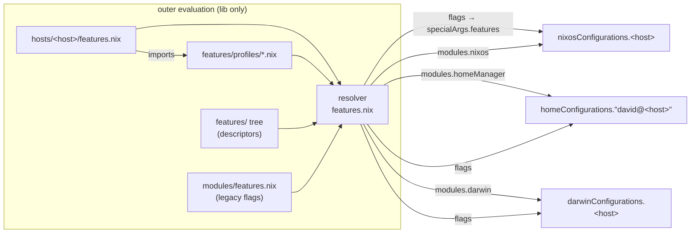
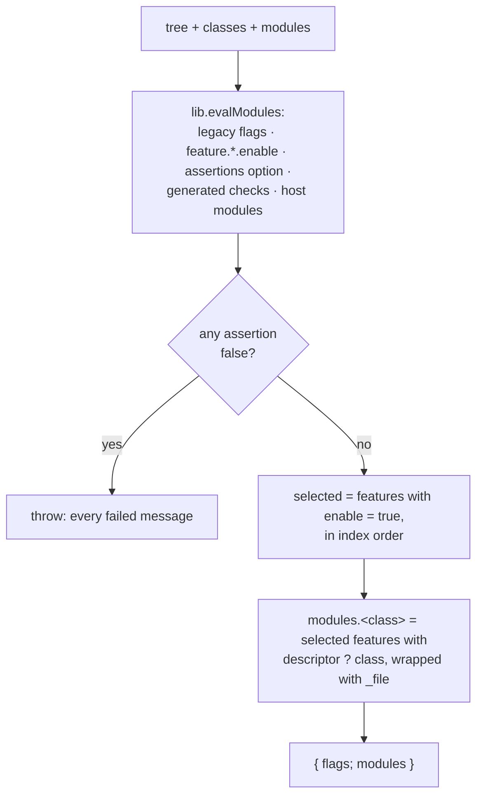

<!-- doctrine:section sec-1 -->
## Overview

### What changes

Today a host chooses its optional modules with boolean **flags**. The flags
are evaluated once, outside every system evaluation, by `features.nix`, and
then passed into NixOS, Home Manager and darwin as the `features`
specialArg. Each host's files read the flags and gate their own imports with
`lib.optional features.x ./x.nix`. The flag table and the import lists are
two things that have to be kept in step by hand, and the two halves of one
feature (system and user) are gated in two different files.

SL-001 adds a second path beside the flags, and moves two features onto it:

- A **feature** is a plain attrset `{ nixos?, homeManager?, darwin? }` whose
  values are ordinary modules. Features live in a **feature tree** under
  `features/`, grouped into **areas**, and are addressed by attribute path
  (`session.snooze`).
- The outer evaluation declares one option per feature,
  `feature.<area>.<name>.enable`, default `false`.
- A **profile** is an outer module that sets those options with `mkDefault`.
  A host imports profiles and can override any of their defaults.
- The resolver checks the final selection (prerequisites, and that every
  selected feature lands somewhere). If a check fails it refuses to return
  anything. Otherwise it **projects** the selected features into one module
  list per class (`nixos`, `homeManager`, `darwin`).
- The host factories in `hosts.nix` append those lists to their `modules`.
  No downstream module reads the new selection.

Snooze (system half plus user half) and openrgb (system only, off on
Sleipnir) move to the new path. Every other feature stays on the flags.

### Why

This is the pilot for ADR-001 to ADR-005. It tests HYP-001's claim that this
small typed resolver, with no dependency graph and no composition library, is
enough for this repo. It also leaves a concrete pattern for later migrations
(MULTIHOST S3–S6).

### The boundary



The diagram shows what each evaluation receives. Selection happens entirely
in the outer evaluation, which uses only `lib`. The three system evaluations
keep their own nixpkgs pins and activation (ADR-003). They receive finished
module lists plus the legacy `flags`, never the new selection. Darwin's
embedded Home Manager receives nothing projected (DEC-001).

### Effective behaviour

Nothing changes for any host. Sleipnir selects snooze through the
`workstation` profile and leaves openrgb off, as today. The Mac selects
neither, so it projects nothing. Today it selects snooze but ignores it.
Every configuration's derivations stay identical.

<!-- doctrine:section sec-2 -->
## Feature tree, descriptors and profiles

### Layout

```
features/
  default.nix                  areas, in projection order
  hardware/
    default.nix                features of the area, in order
    openrgb.nix                nixos half (moved from modules/nixos/openrgb.nix)
  session/
    default.nix
    snooze/
      default.nix              descriptor
      nixos.nix                RTC wake timer   (moved from modules/nixos/snooze.nix)
      home.nix                 bedtime nag      (moved from modules/home/linux/snooze.nix)
      bin/snooze-nag           script           (moved, with its test)
      bin/snooze-nag-test
  profiles/
    workstation.nix            outer profile; not an area
```

The depth is fixed at two levels, `<area>.<name>` (DEC-003). Areas are
ordered `hardware` then `session`, which matches the order of today's gated
NixOS imports (openrgb before snooze). A feature with assets or tests is a
directory. A small one is a single file or an inline value (ADR-002 D3).
Nothing in `features/` is found by listing directories. Every feature is
reached from a written list (ADR-002 D7).

### Index files

Every index is a list of `{ name; value; }` pairs, the shape
`builtins.listToAttrs` takes. The list position is the projection order
(ADR-002 D5).

```nix
# features/default.nix
[
  { name = "hardware"; value = import ./hardware; }
  { name = "session";  value = import ./session; }
]

# features/hardware/default.nix
[
  { name = "openrgb"; value = { nixos = ./openrgb.nix; }; }
]

# features/session/default.nix
[
  { name = "snooze"; value = import ./snooze; }
]
```

### Descriptors

A descriptor is plain data. It is never a module of any evaluator itself
(ADR-002 D1).

```nix
# features/session/snooze/default.nix
{
  nixos = ./nixos.nix;
  homeManager = ./home.nix;
}
```

| key | type | meaning |
|---|---|---|
| `nixos`, `homeManager`, `darwin` | module (path, attrset or function) | the half for that class; absent = this feature contributes nothing there |
| `requires` | list of `"<area>.<name>"` | features that must also be selected (DEC-005) |

The resolver may test whether a key is present, and may read `requires`. It
never imports or applies a class value (ADR-002 D4). An unselected feature's
modules, and the packages they name, are therefore never evaluated.

Neither snooze nor openrgb has prerequisites. `requires` exists for test 3
and later features.

### Profiles

A profile is an ordinary module of the outer evaluation, and sets only
`mkDefault` values (DEC-004):

```nix
# features/profiles/workstation.nix
{lib, ...}: {
  feature.session.snooze.enable = lib.mkDefault true;
}
```

A host selects profiles by importing them:

```nix
# hosts/Sleipnir/features.nix
{
  imports = [../../features/profiles/workstation.nix];
  games.enable = true;   # legacy flags unchanged
  # …
}
```

- A host may import several profiles, and a profile may import others.
- If profiles disagree at equal priority, evaluation fails. The host
  settles it with a plain definition, which always beats `mkDefault`.
- A profile that selects a feature also selects that feature's
  prerequisites.

### Namespace during coexistence

The legacy flags (`games.enable`, `desktop.sway`, `speech`, …) keep their
top-level names. The new options sit beside them under `feature`, so no path
can be both a boolean flag and a feature (DEC-002). `snooze` and
`hardware.openrgb` are removed from the flags, because they are migrated.

<!-- doctrine:section sec-3 -->
## Resolver

### Contract

```
features.nix : lib → { tree, classes, modules } → { flags, modules }   (or throws)

tree     [ { name = area; value = [ { name; value = descriptor; } … ]; } … ]
classes  the evaluations this host has: [ "nixos" "homeManager" ] | [ "nixos" ] | [ "darwin" ]
modules  outer modules for this host: its features.nix (if any), plus extras such as a coverage override

flags    the legacy flag config; becomes specialArgs.features
modules  { nixos = [ … ]; homeManager = [ … ]; darwin = [ … ]; }
```

The resolver is a pure function of its arguments. It does not find a
host's file or the real tree itself; `hosts.nix` passes both in. Tests can
therefore resolve fixture trees without touching `features/`.

### Steps



The flowchart shows the single path through the resolver. The only branch
is the assertion check, and a failure produces no result at all.

1. **Flatten** the tree into a list of records
   `{ area; name; path = "<area>.<name>"; descriptor; }`, keeping index order.
2. **Evaluate** the outer modules:
   - `modules/features.nix`, the legacy flags, unchanged apart from the two
     removed flags;
   - the generated options, `feature.<area>.<name>.enable = mkEnableOption …`;
   - an `assertions` option with the NixOS shape:
     `listOf { assertion : bool; message : str; }`;
   - a generated module that adds two kinds of check, below;
   - the host's `modules`, which bring in its profiles.
3. **Checks**, for each feature that is selected in the final merged config:
   - every path in `requires` is selected. Otherwise:
     `feature.<path> requires feature.<r>, which is not selected`. An unknown
     path in `requires` throws `unknown feature <r> in <path>.requires`;
   - its descriptor has at least one of `classes` (ADR-005 D6, presence test
     only). Otherwise:
     `feature.<path> is selected but has no module for this host's evaluations (<classes>)`.
   Hand-written assertions in any outer module are checked the same way.
   They are the escape hatch for relations that `requires` cannot express.
4. **Enforce.** If any assertion is false, `throw` one message listing all
   failures. The whole result is behind this check, so reading `flags` or
   any `modules.<class>` fails. A home-only build fails exactly like a system
   build (ADR-001 D5). `throw` rather than `abort`, so that tests can catch
   it with `builtins.tryEval`.
5. **Project.** For each class, map the selected records, in order, that have
   that class to `{ _file = "features/<area>/<name>#<class>"; imports = [ descriptor.<class> ]; }`.
   The wrapper records where the module came from, for error messages
   (ADR-002 D6). It treats a path and an inline module the same way.
6. **Return** `{ flags = removeAttrs config [ "feature" "assertions" ]; modules; }`.
   Removing `feature` means no downstream module can read the new selection
   (ADR-001, trailing paragraph).

### Sketch

This shows the intended shape and size, not final code.

```nix
lib: {tree, classes, modules}: let
  inherit (lib) concatMap filter mkEnableOption mkOption types;

  records = concatMap (area:
    map (f: {
      area = area.name;
      inherit (f) name;
      path = "${area.name}.${f.name}";
      descriptor = f.value;
    })
    area.value)
  tree;

  options = {
    options.feature = lib.listToAttrs (map (area: {
        inherit (area) name;
        value = lib.listToAttrs (map (f: {
            inherit (f) name;
            value.enable = mkEnableOption "feature ${area.name}.${f.name}";
          })
          area.value);
      })
      tree);
    options.assertions = mkOption {
      type = types.listOf (types.submodule {
        options.assertion = mkOption {type = types.bool;};
        options.message = mkOption {type = types.str;};
      });
      default = [];
    };
  };

  checks = {config, ...}: let
    on = path:
      lib.attrByPath (lib.splitString "." path ++ ["enable"])
      (throw "unknown feature ${path}")
      config.feature;
  in {
    assertions = concatMap (r:
      lib.optionals (on r.path) (
        map (p: {
          assertion = on p;
          message = "feature.${r.path} requires feature.${p}, which is not selected";
        }) (r.descriptor.requires or [])
        ++ [{
          assertion = lib.any (c: r.descriptor ? ${c}) classes;
          message = "feature.${r.path} is selected but has no module for this host's evaluations (${lib.concatStringsSep ", " classes})";
        }]
      ))
    records;
  };

  inherit ((lib.evalModules {modules = [./modules/features.nix options checks] ++ modules;})) config;

  unique = lib.allUnique (map (a: a.name) tree) && lib.allUnique (map (r: r.path) records);
  failed = filter (a: !a.assertion) config.assertions;
  selected = filter (r: config.feature.${r.area}.${r.name}.enable) records;
  project = class:
    map (r: {
      _file = "features/${r.area}/${r.name}#${class}";
      imports = [r.descriptor.${class}];
    })
    (filter (r: r.descriptor ? ${class}) selected);
in
  if !unique
  then throw "feature tree has a duplicate area or feature name"
  else if failed != []
  then throw "feature selection failed:\n${lib.concatMapStrings (a: "- ${a.message}\n") failed}"
  else {
    flags = removeAttrs config ["feature" "assertions"];
    modules = lib.genAttrs ["nixos" "homeManager" "darwin"] project;
  }
```

### Invariants

- Nothing is selected automatically. Every `enable = true` traces to a
  host or profile definition (DEC-005, HYP-001).
- Projection order is index order. `attrNames` is never used for
  ordering (ADR-002 D5).
- The resolver touches descriptors only through `?`, `requires`, and the
  class value it puts inside `imports`, which the resolver itself never
  forces (ADR-002 D4).
- One record per path (ADR-002 D6). A duplicate area or feature name fails
  resolution before anything else is checked. Otherwise `listToAttrs` would
  silently keep one of the duplicates, while projection emitted both.

