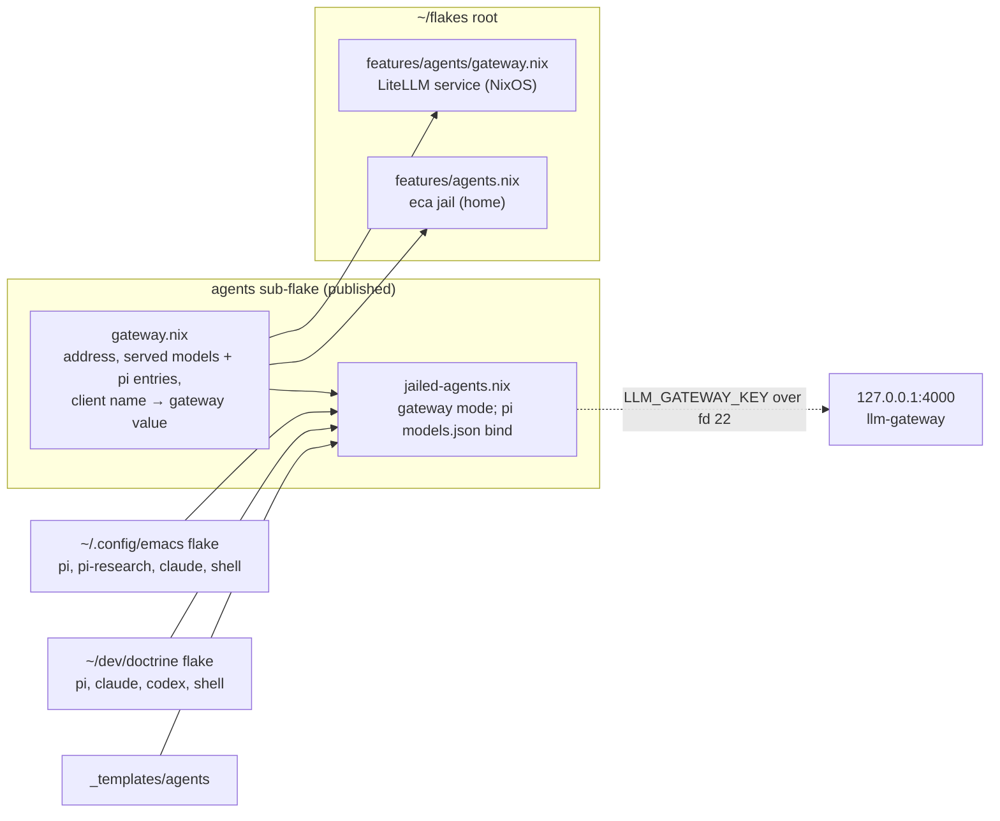
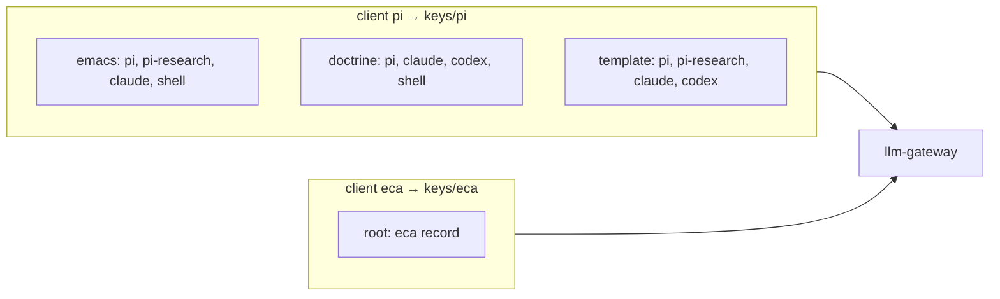
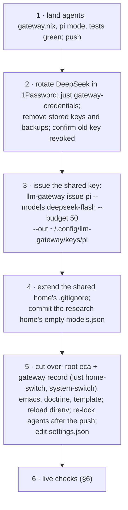

<!-- doctrine:section sec-1 -->
## Shape

SL-011 built a local LLM gateway: a LiteLLM proxy on `127.0.0.1:4000` that
holds the provider keys and gives each client its own key, model list and
budget. Only the jailed eca uses it. This slice moves pi onto it, and with pi
every jail that can launch pi: those the Emacs devshell builds, those in
`~/dev/doctrine`, and those the agents template generates. Afterwards no jail
in those three places receives a provider key, and the provider keys that pi
stored in its shared home are gone.



`agents/gateway.nix` becomes the one place that says where the gateway is,
which models it serves, and how pi should talk to each one. The root's
gateway service and every jail read it; nothing copies it. A jail opts in by
naming its client (`gatewayClient "pi"`); the key file is
`~/.config/llm-gateway/keys/<client>`.

pi needs one thing eca did not: a provider definition. pi reads providers from
`models.json` in its agent directory, which every specDev jail shares
(`~/.local/share/jail.nix/home/agent/.pi/agent/`). In a gateway jail with pi
in it, a Nix-generated `models.json` with one provider, `llm-gateway`, is
bound read-only over the shared file. Non-gateway jails still see the
original.

**Boundary.** In scope: the `agents` sub-flake, the root's gateway and eca
records, the Emacs flake, `~/dev/doctrine`, the template, and the shared pi
home's settings and stored keys. Out of scope: the other `~/dev/*` project
flakes (follow-up), satan's jails and patcher (IMP-030), new gateway models
or providers (IMP-029), OAuth-signed harnesses (claude, codex sign in their
own way and keep doing so), and Emacs's in-process gptel. `agents` stays off
by default: gateway mode is something a consumer turns on.

<!-- doctrine:section sec-2 -->
## `agents/gateway.nix`: one source for the gateway's address and models

**Today.** The address lives in `features/agents/gateway/constants.nix`
(root), the served models in `proxy.nix`'s `defaults.models` (root), and eca
assembles its `gateway` value by hand from the constants
(`features/agents.nix:56-67`). Out-of-tree flakes cannot import the root, so
they would have to copy literals.

**Target.** A new file in the published sub-flake, plain data with one
function, imported with no arguments:

```nix
# agents/gateway.nix — where the local LLM gateway is, what it serves, and
# how pi talks to each model. Plain data: the gateway service, its checks and
# every jail import it; nothing copies it.
rec {
  runtimeDirectory = "llm-gateway"; # /run/<this>; the unit's RuntimeDirectory=
  socket = "/run/${runtimeDirectory}/api.sock";
  relayPort = 4000; # 4001 is taken on Sleipnir
  url = "http://127.0.0.1:${toString relayPort}/v1";
  keyDirectory = "$HOME/.config/llm-gateway/keys"; # expanded by the jail wrapper's shell

  # gateway model name -> LiteLLM model id, the provider whose key it uses,
  # and pi's entry for it (DEC-063: copied from pi's built-in entry for the
  # upstream model, checked through the gateway; LiteLLM's price map has no
  # compat or thinking levels).
  models.deepseek-flash = {
    model = "deepseek/deepseek-flash";
    provider = "deepseek";
    pi = {
      name = "DeepSeek V4.1 Flash";
      reasoning = true;
      input = ["text" "image"];
      contextWindow = 1000000;
      maxTokens = 384000;
      thinkingLevelMap = {minimal = null; low = "low"; medium = null; high = "high"; max = "max";};
      compat = {
        supportsStore = false;
        supportsDeveloperRole = false;
        maxTokensField = "max_tokens";
        requiresReasoningContentOnAssistantMessages = true;
        thinkingFormat = "deepseek";
        supportsStrictMode = true;
      };
    };
  };

  # A jail's `gateway` argument for one client. The client name is the key
  # file's name. The key in it is first issued under the same ledger alias;
  # a rotation re-issues it under a new alias into the same file (DEC-051).
  client = name: {
    keyFile = "${keyDirectory}/${name}";
    inherit url;
    runDirectory = "/run/${runtimeDirectory}";
  };
}
```

**Consumers.**

| consumer | reads | how |
|---|---|---|
| `features/agents/gateway/constants.nix` | address fields | becomes `import ../../../agents/gateway.nix`, so the NixOS record's existing imports are untouched |
| `features/agents/gateway/proxy.nix` | `models` | `defaults.models = mapAttrs (_: m: {inherit (m) model provider;}) gateway.models`; `configDir`'s `models` argument keeps its default, so the check's own models are unaffected |
| `features/agents/gateway.nix` (NixOS record) | `models` | the `services.llm-gateway.models` option is removed; the service config and the provider assertion read `proxy.defaults.models`. `services.llm-gateway.providers` stays an option: only the system reads it |
| `jailed-agents.nix` | `client`, `models` | exported as `gatewayClient = gateway.client` beside `makeJailedPi`; `models` feeds pi's `models.json` (§3) |
| eca record, Emacs, doctrine, template | `gatewayClient` | `gateway = jailLib.gatewayClient "<client>";` |

The root imports the file by relative path, not through `inputs.agents`.
The gateway service and its checks then always read the same commit as the
service itself; the jails read it through `agents` like everything else in
the sub-flake. With `just`'s tree override the two are the same file; from
the lock they can differ until `agents` is re-locked, which is the existing
rule for every `agents` change.

**Invariants.**

- Every served model has a `pi` block. pi's `models.json` generation reads
  it as `m.pi or (throw "agents/gateway.nix: served model ${name} has no pi
  entry")`, so a model without one fails evaluation, naming the model.
- One list of served models. What the gateway serves and what pi is told
  exists are the same attrset, so within one revision of `agents` they cannot
  drift. A consumer reading a locked `agents` sees the list at that revision:
  between a model change and its re-lock, its pi may miss a new model or list
  one the service dropped. That fails safe, because the gateway checks every
  request against the key's own model list. The served models are
  shared across evaluations (system service, home and out-of-tree jails),
  which no NixOS option can carry; hence no per-host override, and a model
  change is an edit to this file. Only Sleipnir runs the gateway.
- The address is a fixed fact, not a tunable: a constant file every
  consumer imports, which is the form REV-009 adds to ADR-004 D4.
- Nothing secret: the key directory is a path, the keys stay in their files
  (POL-001 r1). The file is public with the sub-flake, as `constants.nix`
  already is.

**Names.** `gatewayClient` in the jail library (DEC-059's name); `client`
inside the data file, where `gateway.client "pi"` already says what it is.

<!-- doctrine:section sec-3 -->
## pi gateway mode: a store `models.json` bound over the shared one

**Today.** Gateway mode (`agents/jailed-agents.nix`, `gatewayOptions`) gives a
jail `LLM_GATEWAY_URL` and, over file descriptor 22, `LLM_GATEWAY_KEY`, and no
provider key. eca is configured by hand to use them. pi reads its providers
only from `~/.pi/agent/models.json`, and every specDev jail shares that file
through `persist-home "agent"`, so nothing in it can be gateway-specific.

**Target (DEC-058, DEC-063).** When a jail is in gateway mode and pi is in it,
as the agent or as a subagent, a generated `models.json` is bound read-only
over `~/.pi/agent/models.json`:

```nix
# top level of jailed-agents.nix, exported beside gatewayClient so the test
# can call it with any model set.
# pi's provider for the gateway: one provider, named apart from every
# built-in so no stored auth.json credential matches it (P1, P4). baseUrl is
# literal (pi does not interpolate it); apiKey is read from the environment
# per request.
piGatewayConfig = url: models: {
  providers.llm-gateway = {
    baseUrl = url;
    api = "openai-completions";
    apiKey = "$LLM_GATEWAY_KEY";
    models = lib.mapAttrsToList (id: m:
      {inherit id;}
      // m.pi or (throw "agents/gateway.nix: served model ${id} has no pi entry"))
    models;
  };
};

# in makeJailedAgent, beside gatewayOptions
# pi is in the jail as the agent (makeJailedPi, whatever its `name`, e.g.
# pi-research) or as a subagent. Derivations compare by output path.
piInJail = agent == pi || lib.elem "pi" subagentNames;

piGatewayModels = pkgs.writeText "pi-gateway-models.json"
  (builtins.toJSON (piGatewayConfig checkedGateway.url (import ./gateway.nix).models));

piGatewayOptions = lib.optionals (gateway != null && piInJail) [
  (jail.combinators.unsafe-add-raw-args "--ro-bind ${piGatewayModels} ~/.pi/agent/models.json")
];
```

`piGatewayOptions` goes into `inner`'s option list after `profileOptions`, so
the bind lands on top of the persisted home, the same ordering rule as the
host git excludes (`hostGitExcludesOptions`). The rendered file for today's
one model:

```json
{"providers":{"llm-gateway":{
  "baseUrl":"http://127.0.0.1:4000/v1","api":"openai-completions",
  "apiKey":"$LLM_GATEWAY_KEY",
  "models":[{"id":"deepseek-flash","name":"DeepSeek V4.1 Flash","reasoning":true,
    "input":["text","image"],"contextWindow":1000000,"maxTokens":384000,
    "thinkingLevelMap":{"minimal":null,"low":"low","medium":null,"high":"high","max":"max"},
    "compat":{"supportsStore":false,"supportsDeveloperRole":false,"maxTokensField":"max_tokens",
      "requiresReasoningContentOnAssistantMessages":true,"thinkingFormat":"deepseek",
      "supportsStrictMode":true}}]}}}
```

pi selects it as `llm-gateway/deepseek-flash`.

**Who gets the bind.**

| jail | gateway | pi in jail | bind |
|---|---|---|---|
| `jailed-pi`, `jailed-pi-research` | yes | agent | yes |
| `jailed-claude`, `jailed-shell`, doctrine's `jailed-codex` | yes | subagent | yes |
| eca | yes | no | no |
| any jail without `gateway` | no | either | no: it sees the shared file unchanged |

**Nested pi.** A subagent runs in its parent's namespace: the
depth-guarded `jailed-pi` wrapper execs the bare pi binary in the same jail.
It therefore sees the parent's mounts, including this bind, and inherits
`LLM_GATEWAY_KEY` from the parent's environment. That is why claude and shell
jails take the pi gateway client (DEC-061, DEC-062): their nested pi is
authenticated with the parent's key and spends on the parent's ledger entry.
An unjailed caller of `jailed-pi` (the host's claude) goes through the
gateway wrapper, which reads the key file on the host and starts a fresh jail.

**pi's writes.** pi only reads `models.json` (1.3.0 `model-config.js`
`ModelConfig.load`). Its writes go elsewhere: catalog refresh to
`models-store.json`, `/login` to `auth.json`, a saved default to
`settings.json`. None meets the read-only bind. Editing `models.json` by hand
inside a gateway jail fails (read-only file system), and so would any tool's
rename over it (busy mount point): edit it from the host or a non-gateway jail.

**First mount.** bwrap creates a missing bind target. Where the persisted home
has no `models.json` (the research home today, any new home), the first
gateway run leaves an empty file in the host directory. pi treats a missing
file as "no custom providers" but warns on an empty one ("Failed to parse
models.json: … Unexpected EOF", checked on 0.99.1), so every later
non-gateway pi on that home starts with that warning; `{"providers":{}}`
loads cleanly.

The launcher does not seed the file. A seed would run on the host before
bwrap, on a path inside the persisted home, which the jail can write: a
planted symlink there would turn the seed into a host-side write the jail
chose. Instead, the one home that lacks the file today, `agent-research`,
gets `{"providers":{}}` as a file tracked in the home repo (rollout step 4,
§5). It holds no secret, and a new machine gets it from the checkout. A home
created later shows the warning in non-gateway jails only; it is cosmetic.

**Off by default.** `gateway` stays `null` unless a caller passes one, so
the 13 direnv devshells that build live `agents` see no change until they opt
in (R1). `piInJail` adds nothing when `gateway == null`.

<!-- doctrine:section sec-4 -->
## Consumers

Every consumer writes the same line, `gateway = jailLib.gatewayClient "<client>";`,
and drops whatever fetched provider keys before. One client, `pi`, serves
every pi-launching jail (DEC-061, DEC-062): pi itself, and the jails whose
nested pi needs a key. A jail gets its own key later by changing the name and
issuing that key; nothing else moves.



### Root (`~/flakes`)

- **eca record** (`features/agents.nix`): `gateway = jailLib.gatewayClient
  "eca";` replaces the hand-built value and the `constants` import. Behaviour
  is unchanged: same key file, URL and run directory.
- **Gateway record** (`features/agents/gateway.nix`): the
  `services.llm-gateway.models` option goes (§2); the service config and the
  provider assertion read `proxy.defaults.models`. The assertion message names
  `agents/gateway.nix` instead of the option.

### Emacs flake (`~/.config/emacs/flake.nix`, its own repo)

| jail | change |
|---|---|
| `jailed-pi` | `gateway = jailLib.gatewayClient "pi";` drop `useOpEnv = false; passApiKeysFromEnv = true;` and the comment about the patch adapter (that adapter is satan's, IMP-030) |
| `jailed-pi-research` | gateway `pi`; subagents `["pi" "claude"]` |
| `jailed-claude` | gateway `pi`; subagents `["pi" "claude"]` |
| `jailed-shell` | gateway `pi`; subagents `["pi" "claude"]` |
| `jailed-opencode`, `jailed-dirge` | deleted (not in use) |
| `jpi` | `exec jailed-pi "$@"`: no `op run` |

`apiKeyJailOptions` loses `(try-fwd-env "OPENROUTER_API_KEY")`, which would
put the key on the bwrap command line, and the duplicate `/usr/bin/env` bind
(the base options already make it). What remains is `pulse` and the hang-up
sound, so it is renamed `soundJailOptions`. The stale comment describing
`--setenv` forwarding goes with `passApiKeysFromEnv`.

The flake runs under direnv's `use flake_local agents`, so the live `agents`
is built on the next reload. Its `flake.lock` is re-locked after `agents` is
pushed, so `nix build`/`nix run` outside direnv agree.

### `~/dev/doctrine` (its own repo)

`mkJail`, the helper every doctrine jail goes through, gains the default:

```nix
mkJail = maker: args:
  maker (
    {
      profile = "specDev";
      extraPkgs = projectPkgs;
      extraOptions = jailEnvOptions;
      gateway = jailLib.gatewayClient "pi";
    }
    // args
  );
```

`jailed-dirge` is deleted and `dirge` leaves the claude and shell subagent
lists. codex signs in by OAuth and loses nothing; its subagents (`claude`,
`pi`, `codex`) stay. Re-locked after the push, as for emacs.

### Template (`_templates/agents/flake.nix`)

A generated project starts on the gateway, with the opt-out written next to
it:

```nix
# Every jail reaches models through the local LLM gateway with the shared
# `pi` key (~/.config/llm-gateway/keys/pi); no provider key enters a jail.
# On a host without the gateway, set `gateway = null` on a jail to fall back
# to `op run` with provider keys (see agents/README.md § Gateway mode).
gateway = jailLib.gatewayClient "pi";
```

Each remaining jail (`jailed-pi`, `jailed-pi-research`, `jailed-claude`,
`jailed-codex`) takes `inherit gateway;`. `jailed-opencode` and
`jailed-gemini` are dropped: both need provider keys or a sign-in the gateway
does not give them. Also removed: the header text that says online profiles
wrap `op run`, the `--setenv` comment, and `(try-fwd-env
"OPENROUTER_API_KEY")`; the per-agent knob list describes `gateway`.
`gatewayClient` is only reached inside the Linux-only `jailPkgs`, so the
Darwin devshell, where `jailLib` is `{}`, is unaffected.

### Not touched

The other `~/dev/*` project flakes keep their pi jails as they are: no
`gateway`, provider keys through `op run`. They pick up the new `agents`
on their next direnv reload, but with `gateway` unset nothing changes for
them (§3). Their migration is a follow-up backlog item.

<!-- doctrine:section sec-5 -->
## Shared pi home and rollout

Every specDev jail in every project shares one pi home,
`~/.local/share/jail.nix/home/agent/.pi/agent/` (on the host). Two of its
files are tracked in the home repo (`settings.json`, `.gitignore`); the rest
is runtime state. This section covers what changes there and the order in
which the whole slice lands.

### Files in the shared home

| file | today | after |
|---|---|---|
| `auth.json` (untracked, ignored) | stored keys `deepseek`, `llama.cpp`; OAuth logins `openai-codex`, `google-gemini-cli`, `google-antigravity` | the two stored keys removed; OAuth logins stay |
| `models.json` (untracked) | providers `deepseek` (`$DEEPSEEK_API_KEY`) and `local-llama` (literal key) | `local-llama` removed (llama-cpp is off on Sleipnir; re-add with an env reference if it returns); `deepseek` stays for non-gateway jails |
| `models.json.backup`, `models.json~` | stale copies holding the `local-llama` key | deleted |
| `settings.json` (tracked) | `defaultProvider: "deepseek"`, `defaultModel: "deepseek-v4-pro"`, `enabledModels: ["deepseek/deepseek-flash"]` | `llm-gateway`, `deepseek-flash`, `["llm-gateway/deepseek-flash"]` |
| `.gitignore` (tracked) | `auth.json` | adds `models.json*` and `models-store.json`, so neither the provider list nor the catalog cache can be staged |
| `agent-research/.pi/agent/models.json` (research home) | absent | `{"providers":{}}`, tracked in the home repo (§3, First mount) |

Keys are removed with `jq` deletions on the named entries; no value is
printed or copied.

**What `settings.json` does and does not do.** It sets the default model for
new sessions. In a gateway jail that is the gateway model. In a jail that
cannot resolve `llm-gateway/deepseek-flash` (no gateway, so the shared
`models.json` has no such provider), pi silently falls back to the first
model it holds credentials for (1.3.0 `model-resolver.js` ~:397-427). That
may be the env-keyed `deepseek` provider or an OAuth subscription model. The
setting does not force an unmigrated jail onto the gateway; the live checks
record what one falls back to. A resumed session keeps the model it was
started with.

### Rollout



| step | who | why here |
|---|---|---|
| 1 | agent | Off by default: landing `agents` changes no consumer until one opts in (R1). |
| 2 | user (1Password, sudo), agent (file edits) | POL-001 r6, rotate first. The stored `deepseek` key has been readable by every specDev jail. Removing the stored copies in the same step means no live copy of the old key outlives the rotation. `op run` consumers resolve the new key on their next launch; an unmigrated pi jail falls back from the removed `auth.json` entry to the env-keyed `deepseek` provider, which `op run` now feeds with the new key. |
| 3 | user (sudo) | Before any consumer needs `keys/pi`; the gateway wrapper names this command if the file is missing. |
| 4 | agent | Before the cutover writes anything new to the home, and before the first gateway run leaves an empty bind target (§3, First mount). |
| 5 | agent; user switches | Settings move at the cutover, not before: changed earlier, they would only redirect unmigrated jails (inq-9). |
| 6 | user, with agent | §6. |

**Exposure that remains.** Rotation revokes the old DeepSeek key but does not
erase it from places it was already written: agent transcripts and session
logs (POL-001 r5; their purge is IDE-005, out of scope). The other
`~/dev/*` flakes and satan keep receiving provider keys through `op run`
until their own migrations (follow-up item, IMP-030). OAuth logins in
`auth.json` let a jail bypass the gateway by design.

**Recovery.** Each step after 1 is reversible on its own: a consumer goes
back by removing `gateway` (or reverting its flake), `settings.json` by
`git` (scoped to its path), and a lost or leaked `pi` key by README § LLM
gateway's rotation: move `keys/pi` aside, issue a new alias with `--out
keys/pi`, revoke the old alias (DEC-051). The file path stays the same, so no
consumer changes; each jail picks up the new key at its next launch. The rotation is the one step that
cannot be undone, and it does not need to be.

<!-- doctrine:section sec-6 -->
## Verification

Three tiers: tests in `just test` (VT), evaluation and builds of the other
repos, checked by the agent (VA), and live checks on the running host (VH).

### VT: `agents/jailed-agents-test.nix` (`checks.jailed-agents`, run by `just test`)

The existing gateway probes stay. `gateway_inner_of` stops hard-coding
`-jailed-pi` and takes the jail name, so research and subagent jails can be
probed. New cases, each with a twin that differs only in the property under
test, as the gateway refusals are written today:

| case | jail | expect |
|---|---|---|
| bind for pi as agent | `makeJailedPi { gateway = gw; }` | launcher has `--ro-bind <store>-pi-gateway-models.json ~/.pi/agent/models.json`, after the persisted-home bind (byte offset, as the git-excludes test) |
| bind for pi under another name | `makeJailedPi { name = "pi-research"; profile = "research"; gateway = gw; }` | same bind |
| bind for pi as subagent | `makeJailedClaude { gateway = gw; subagents = ["pi"]; }` | same bind |
| no bind without pi | `makeJailedEca { gateway = gw; }` | no `models.json` bind |
| no bind without gateway | `makeJailedPi {}` | no `models.json` bind |
| file content | the bound store file | one provider `llm-gateway`; `baseUrl` = `gw.url`; `apiKey` is the literal `$LLM_GATEWAY_KEY`; one model per served alias, equal to `{ id = alias; } // pi` from `agents/gateway.nix` |
| model without a pi entry | `piGatewayConfig gw.url { x = { model = "m"; provider = "p"; }; }` | evaluation fails naming `x`; its twin with a `pi` block evaluates |
| `gatewayClient` | `gatewayClient "pi"` | `keyFile = "$HOME/.config/llm-gateway/keys/pi"`, `url`, `runDirectory = "/run/llm-gateway"` from `gateway.nix` |

The no-key probes already in place (fd 22 carries only the gateway key;
`bwrap` starts from an empty environment; no key name on the command line)
apply unchanged to the new jails.

### VT: root

- `checks.<system>.llm-gateway`: the LiteLLM config built from
  `proxy.defaults.models`, now sourced from `agents/gateway.nix`, still
  serves `deepseek-flash`, and the unpriced-model build still fails.
- `just test`'s evaluation of the hosts: the gateway record evaluates without
  `services.llm-gateway.models`; the eca record's `gateway` value is unchanged
  (same `keyFile`, `url`, `runDirectory` as before the change).

### VA: other repos and outputs

- `~/.config/emacs` and `~/dev/doctrine`: `nix build` of every jail package,
  once with `--override-input agents path:~/flakes/agents` (what direnv
  builds) and once from the re-locked `flake.lock`. Their launchers carry the
  bind, no `op run`, and no `OPENROUTER_API_KEY`.
- The template: `nix flake init -t ~/flakes#agents` into a scratch directory,
  then build its jails with the local `agents` override.
- `just coverage` and `just isolation` still pass (`agents` gained a file,
  no input).

### VH: live, after the cutover (§5 step 6)

1. `jailed-pi` completes a request on `llm-gateway/deepseek-flash`; the `pi`
   alias's spend rises in `llm-gateway list`.
2. Inside that jail: no provider key in `env`, `/proc/1/environ`, or
   `auth.json`; `models.json` is the store file.
3. Thinking is controllable: `--thinking off` gives no reasoning (the drafting
   spike's check, now in the jail).
4. Research: `jailed-pi-research`, whose home has no settings or stored
   credential, completes a request; record the model it selected, and the
   `pi` alias's spend rises.
5. Nested: `jailed-claude` runs `jailed-pi`, which completes a request.
6. Unjailed: the host's claude runs `jailed-pi`, which completes a request.
7. A resumed session started before the cutover: record which model it uses.
8. An unmigrated `~/dev/*` jail: record which model pi falls back to (§5).
9. Rotation: a request with the old DeepSeek key is rejected by DeepSeek;
   `just gateway-credentials` restarted the gateway with the new one (check 1
   passing after rotation shows it).

pi's facts in this design were read from the 1.3.0 source and spiked on
0.99.1, the version installed. When the llm-agents bump builds 1.3.0, VH 1–4
are repeated.

<!-- doctrine:section sec-7 -->
## Code impact and docs

### This repo (`~/flakes`)

| path | change |
|---|---|
| `agents/gateway.nix` (new) | address constants, served models with pi entries, `client` (§2) |
| `agents/jailed-agents.nix` | `piGatewayConfig`; `piInJail`, the store `models.json` and its read-only bind in gateway mode; export `gatewayClient` and `piGatewayConfig` (§3) |
| `agents/jailed-agents-test.nix` | `gateway_inner_of` takes a jail name; the cases in §6 |
| `agents/README.md` § Gateway mode | `gatewayClient` instead of a hand-built value; pi's `models.json` bind, who gets it, and why a home should already hold a `models.json` (the research home's is tracked); adding a served model means its pi block, checked through the gateway |
| `features/agents/gateway/constants.nix` | `import ../../../agents/gateway.nix` |
| `features/agents/gateway/proxy.nix` | `defaults.models` from `agents/gateway.nix`, `pi` stripped |
| `features/agents/gateway.nix` | `services.llm-gateway.models` option removed; config and assertion read `proxy.defaults.models`; assertion message names `agents/gateway.nix` |
| `features/agents.nix` | eca: `gateway = jailLib.gatewayClient "eca";`, `constants` import dropped |
| `_templates/agents/flake.nix` | one `gateway` binding with the opt-out comment; opencode and gemini dropped; `op run`/`--setenv` text and the OpenRouter forward removed (§4) |
| `README.md` § LLM gateway | clients now eca and the `pi` key; "Adding a client" via `gatewayClient`; "another model" edits `agents/gateway.nix` (no option); "What it does not cover" names the remaining `op run` consumers (other `~/dev/*` flakes, satan) |

### Outside this repo (not selectors: the selector set covers `~/flakes` only)

| path | repo | change |
|---|---|---|
| `~/.config/emacs/flake.nix`, `flake.lock` | emacs | §4 jail changes; `soundJailOptions`; re-lock `agents` after the push |
| `~/dev/doctrine/flake.nix`, `flake.lock` | doctrine | `mkJail` default; `jailed-dirge` deleted; re-lock |
| `~/.local/share/jail.nix/home/agent/.pi/agent/settings.json`, `.gitignore` | home repo (`~`, tracked, outside `~/flakes`) | §5; staged by explicit path |
| `~/.local/share/jail.nix/home/agent-research/.pi/agent/models.json` (new) | home repo (`~`, outside `~/flakes`) | `{"providers":{}}` (§3, First mount); added by explicit path |
| `~/.local/share/jail.nix/home/agent/.pi/agent/`: `auth.json`, `models.json`, `models.json.backup`, `models.json~` | untracked | §5 key removal; nothing staged |

### Records touched at reconcile

- REV-009 (ADR-004 decision 4 admits imported constants) is applied.
- POL-001's verification gains a gateway line (deferred from SL-011's reconcile).
- Memory `mem.fact.bwrap.pid1-environ-leak`: its claim that the emacs
  `jailed-shell` misses the environment fix is wrong (research); corrected.
- Backlog: migrate the remaining `~/dev/*` project flakes' pi jails.

