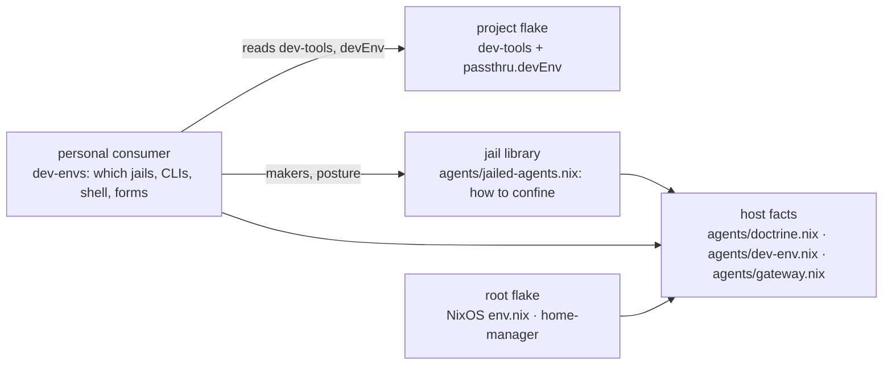
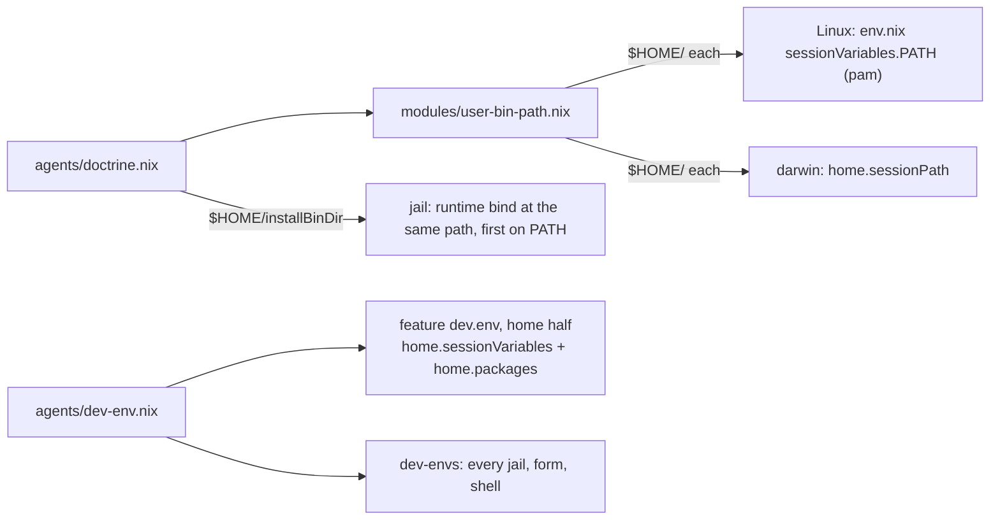
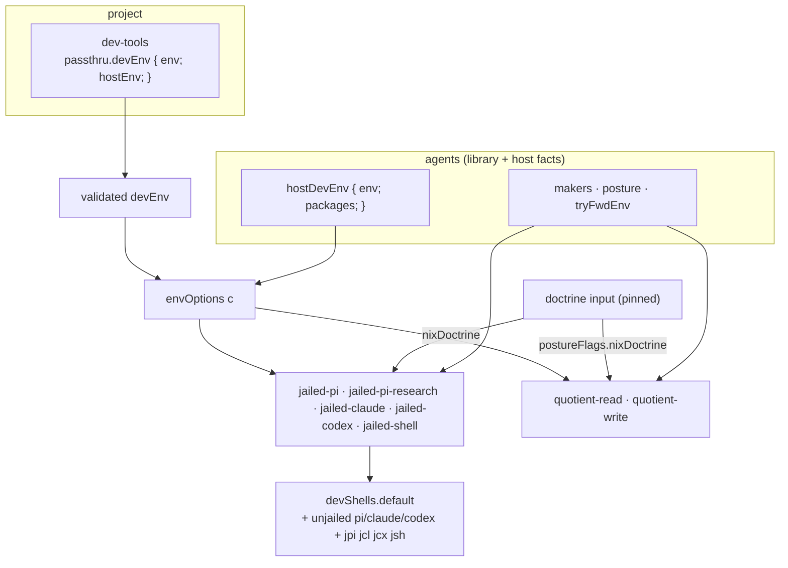
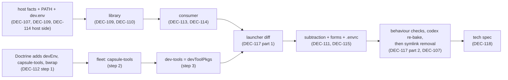

<!-- doctrine:section sec-arrangement -->
## Arrangement and goal

**What changes.** Doctrine (`~/dev/doctrine`) stops building its own agent
environment. It exports its tools and a little plain data about what they need;
the personal consumer (`~/flakes/dev-envs`) builds the jails, the Quotient forms
and the shell around it, the same way for every project. Facts true of this host
whatever the project — where Doctrine is installed, the order of user bin
directories on PATH, env preferences such as sccache and mold — are spelled once
and reach host shells and jails alike.

**Why.** Today one fact has several owners. Doctrine's install directory is
written in `modules/nixos/env.nix`, zsh's init, the jail library and six project
flakes. The PATH order is set by pam, then re-prepended by zsh. The jail binds
Doctrine at `/run/doctrine-bin`, a path that does not exist on the host, so
`doctrine install` records (bakes) whichever path it ran from, and that path is
wrong on the other side of the jail wall.

**Boundary.** Three repositories and the host: `~/flakes` (host facts, jail
library, consumer, root flake), `~/dev/doctrine` (its flake shrinks to a
producer) and `/srv/fleet` (the capsule target names a new output). The six other
project flakes that bind Doctrine themselves are not changed here; their binds
become redundant and go in the rollout.

### The four layers (DEC-108)

Each fact has one owner, and the dependency arrow runs one way. Arrows point from
reader to what it reads.



The consumer reads host facts directly because it applies the env list to every
jail, form and its own shell. The root flake reads host facts by relative path
and never reads the consumer.

| layer | owns | test for a new item |
|---|---|---|
| host facts (`agents/*.nix`, plain data) | Doctrine's directories, env preferences, the gateway's address | true of this host, whatever the project |
| jail library (`agents/jailed-agents.nix`) | posture, makers, combinators; applies host facts | true of every jail anyone builds here |
| personal consumer (`dev-envs`) | the jail set, unjailed CLIs, shorthands, forms, pinned builds | my preference for working on any project |
| project (`dev-tools` + `passthru.devEnv`) | its tools and what they need, with no agent concepts | true of the project, whoever works on it |

### Host facts

**`agents/doctrine.nix`** (new, DEC-109), plain data in the shape of
`agents/gateway.nix`:

```nix
# agents/doctrine.nix — where this host's Doctrine lives. Plain data: the
# NixOS env, the darwin home and the jail library import it; nothing copies it.
{
  # just install's root (cargo install --root ~/.local/share/doctrine), home-relative.
  installBinDir = ".local/share/doctrine/bin";
  # Where a jail sees a supplied Nix-built Doctrine: read-only, never on PATH.
  nixBinDir = "/run/doctrine-nix-bin";
}
```

No new environment variable is exported. `DOCTRINE_BIN` keeps its meaning: a
per-checkout override, unset by default, which Doctrine's `justfile` reads before
falling back to `./target/debug/doctrine` (DEC-109).

**`agents/dev-env.nix`** (new, DEC-114): env preferences for every project, kept
beside the packages that make them work. `RUSTC_WRAPPER=sccache` without sccache
on PATH breaks every cargo call, so a variable and its package are one fact, and
whoever applies one applies both:

```nix
# agents/dev-env.nix — the env every project gets on this host: host shells
# (the dev.env feature) and every jail, form and consumer shell (dev-envs).
rec {
  env = {
    CLAUDE_CODE_EXPERIMENTAL_AGENT_TEAMS = "1";
    RUSTC_WRAPPER = "sccache";
    UV_PYTHON_PREFERENCE = "only-system";
  };
  linuxEnv.CARGO_BUILD_RUSTFLAGS = "-C link-arg=-fuse-ld=mold"; # mold cannot emit Mach-O
  # The env and its packages for one platform.
  for = pkgs: let
    linux = pkgs.stdenv.isLinux;
  in {
    env = env // (if linux then linuxEnv else {});
    packages = [pkgs.sccache] ++ (if linux then [pkgs.mold] else []);
  };
}
```

`SCCACHE_DIR` is left out: sccache's Linux default (`~/.cache/sccache`) is taken
to equal the value Doctrine's `.envrc` sets today. Checked at execution.

### The user-bin PATH (DEC-107)

One ordered list of home-relative directories, Doctrine's first, in
**`modules/user-bin-path.nix`** (new). It lives in `modules/`, not `agents/`,
because only the root flake reads it; `agents/` is what the library and
out-of-tree consumers see.

```nix
# modules/user-bin-path.nix — user bin directories whose order matters,
# home-relative. pam (Linux) and home-manager (darwin) prepend them; shells only append.
let
  doctrine = import ../agents/doctrine.nix;
in [
  doctrine.installBinDir
  ".local/bin"
  ".local/bin/scripts"
  ".cargo/bin"
  "go/bin"
  ".pnpm-global/bin"
  ".npm-global/bin"
]
```

How each host fact reaches its consumers:



- **Linux.** `env.nix` keeps pam as the owner: it is the only layer that reaches
  GUI apps and systemd user units. Its list is replaced by the shared one, which
  moves Doctrine's directory ahead of `~/.local/bin`.
- **darwin.** `modules/home/darwin/default.nix` gains `home.sessionPath` from the
  same list.
- **Shells only append.** `init.zsh` loses its
  `path=(~/bin ~/.local/bin ~/.local/bin/scripts ~/.cargo/bin $path)`; `~/bin`
  does not exist and is dropped. Nushell's `path add` of `~/nushell` already
  appends.
- **The symlink goes, last.** Baked paths do not follow PATH: codex's
  registration bakes the PATH entry's own path (`doctrine:src/codex_mcp.rs:210-224`,
  `doctrine:DEC-404`), so today's `~/.codex/config.toml` starts the server as
  `~/.local/bin/doctrine` (absolute), the symlink (RV-046 F-1). The migration runs
  in order:
  1. Land the user-bin PATH; open a fresh login.
  2. Re-run `doctrine install` on the host and inside a jail. pi's bake
     (`current_exe()`) and codex's (the PATH entry, now the install directory)
     both record `~/.local/share/doctrine/bin/doctrine`, which the jail binds at
     that same path (S5).
  3. Check the recorded command in the host's and the jail's persisted
     `~/.codex/config.toml`, and start the MCP server from a fresh codex on each
     side. Grep the jails' persisted homes for a baked `/run/doctrine-bin`.
  4. Only then remove `~/.local/bin/doctrine` by hand. Rollback: recreate it.
- **The env list on the host.** A new feature, `dev.env` in `features/dev.nix`,
  selected by `features/profiles/personal.nix` (Linux and darwin). Its home half
  sets `home.sessionVariables` and `home.packages` from
  `(import ../agents/dev-env.nix).for pkgs`, the variables and their packages
  together. It is a feature, not the home base: a home works without a compiler
  cache or a linker preference (SPEC-002 § Where config lives, rule 1; RV-046
  F-3). On Linux, the existing
  `systemd.user.sessionVariables = config.home.sessionVariables` carries the list
  to GUI-launched processes; nushell reads it through `loadSessionVariables`.

**Invariant.** In a fresh login shell, on the host and in a jail, `type -a
doctrine` shows exactly one entry: `$HOME/.local/share/doctrine/bin/doctrine`.

**Assumptions** (checked at execution, not settled here):

- On darwin, nu inherits `home.sessionPath`, because zsh's login hook has sourced
  `hm-session-vars.sh` before `exec -l nu`.
- quotient's form check accepts a `$HOME/…` PATH entry on the bwrap line
  (DEC-110's own caveat); if not, the PATH entry is set at run time too.

<!-- doctrine:section sec-library -->
## The jail library: Doctrine at its host path (DEC-109, DEC-110)

**Current.** `hostDoctrineOptions` (`agents/jailed-agents.nix:373-382`) binds
`~/.local/share/doctrine/bin` at `/run/doctrine-bin` as a static option, puts
`/run/doctrine-bin` on the jail's PATH, and binds the binary's ELF closure at
run time. Its comment says "at its own path"; the code does not.

**Target.** The install directory is bound at its own host path, read-only, as a
**runtime** argument. `posture` runs before `profileOptions`, whose persisted
home binds a host directory over `~`, so a static bind under `~` from `posture`
would be hidden by it. Runtime arguments follow every static one (the
git-excludes bind at `:146-150` relies on the same thing, and
`jailed-agents-test.nix:495-503` pins it). `/run/doctrine-bin` goes.

```nix
# agents/jailed-agents.nix
doctrineFacts = import ./doctrine.nix;
# A shell word, expanded by the launcher at run time.
hostDoctrineDir = ''"$HOME/${doctrineFacts.installBinDir}"'';
hostDoctrineOptions = c:
  with c; [
    (add-runtime ''
      RUNTIME_ARGS+=(--ro-bind-try ${hostDoctrineDir} ${hostDoctrineDir})
      mapfile -d "" -t doctrine_binds < <(${elfClosureBinds} ${hostDoctrineDir}/doctrine)
      RUNTIME_ARGS+=("''${doctrine_binds[@]}")
    '')
    (add-path hostDoctrineDir) # as the six project flakes spell it (e.g. smut/flake.nix:177-181)
  ];
```

The jail's `$HOME` is the host's path (persist-home binds onto `~`), so the
directory, the PATH entry and every baked path agree across the wall. The two
rationale bullets in the existing comment (a directory, never the file —
IMP-249; not over `~/.cargo/bin`) still hold and stay.

**PATH position.** A later `add-pkg-deps` prepends to PATH (`posture`'s own
comment, `:424-431`), so the launcher's packages come before this entry. What
the design needs is uniqueness, not position: once Doctrine's `dev-tools` stops
carrying the product (DEC-112), and the Nix build is mounted off PATH (below),
the host install is the only `doctrine` a jail can find. DEC-110's "first on the
jail PATH" is met in that sense.

### The Nix-built Doctrine, off PATH (DEC-109)

`posture` and `makeJailedAgent` gain one argument, `nixDoctrine ? null`: a
package whose `bin/` is bound read-only at `doctrine.nixBinDir`
(`/run/doctrine-nix-bin`) and never added to PATH. It is a store path, so the
bind is static and passes quotient's form check. Forms take it through
`postureFlags.nixDoctrine`.

```nix
posture = {sandboxGitIdentity, hostDoctrine ? true, nixDoctrine ? null, …}: c:
  baseJailOptions c
  ++ lib.optionals hostDoctrine (hostDoctrineOptions c)
  ++ lib.optional (nixDoctrine != null)
       (c.ro-bind "${lib.getBin nixDoctrine}/bin" doctrineFacts.nixBinDir)
  ++ …
```

A reference build at a known path that cannot be reached by accident: only a
caller that names `/run/doctrine-nix-bin/doctrine` runs it. Its closure must be
visible in the jail; the library test runs it there (Verification).

### Host facts the library exports

The library already exports the gateway's facts for out-of-tree clients
(`gatewayFacts`, `:643`). It exports the env list the same way, resolved for its
own `pkgs`, so the consumer reads neither file by path:

```nix
# mkJailedAgents' result
hostDevEnv = (import ./dev-env.nix).for pkgs;   # { env; packages; }
```

The library does not *apply* `hostDevEnv`. Which env a jail gets is the
consumer's choice (DEC-108); the library only holds the facts and the
combinators (`set-env`, `tryFwdEnv`) that apply them.

### What changes with it

- `agents/jailed-agents-test.nix`: the four `/run/doctrine-bin` sites
  (`:511-512`, `:545`, `:562`) assert the host-path runtime bind and PATH entry
  instead; a new case asserts `nixDoctrine` binds at `/run/doctrine-nix-bin` and
  adds nothing to PATH; `posture`'s comment about its "one static mount" is
  rewritten (there is none under `~` now).
- `agents/README.md`: the `hostDoctrine` posture bullet (`:68-70`) and the
  option table (`:596`) name the host path; `nixDoctrine` gets a row.
- The six project flakes' own host-path binds now duplicate the library's,
  harmlessly; the rollout removes them.

<!-- doctrine:section sec-consumer -->
## The consumer: five jails, one shell, the project's env (DEC-113, DEC-114)

**Current.** `dev-envs/flake.nix` builds one jail (`packages.jail`, a
`makeJailedPi`), two forms and `devShells.jail`, all from the project's
`dev-tools`. The project can state nothing beyond its packages.

**Target.** Five jails named by artefact, the same for every project; one
default shell carrying them and their shorthands; the project's stated env and
the host's env list applied to every jail, form and the shell; a pinned Nix
Doctrine mounted in each (DEC-109). The consumer stays keyless (SL-022 D3) and
Linux-only (DEC-106, confirmed by DEC-116).



### The flake (the parts that change)

```nix
inputs = {
  # … nixpkgs, agents, quotient, project as today …
  # A pinned reference Doctrine, mounted at /run/doctrine-nix-bin in every
  # jail and form, never on PATH (DEC-109). Built locally on each lock bump.
  doctrine.url = "github:davidlee/doctrine";
};

perSystem = system: let
  pkgs = nixpkgs.legacyPackages.${system};
  inherit (pkgs) lib;
  jailLib = agents.lib.${system}.mkJailedAgents {inherit pkgs;};
  devTools = …; # unchanged: the producer contract's throw

  # What the project's tools need (DEC-114). Absent: nothing (DEC-105).
  devEnv = checkDevEnv (devTools.devEnv or {});
  inherit (jailLib) hostDevEnv;
  env = hostDevEnv.env // devEnv.env;
  envOptions = c:
    lib.mapAttrsToList c.set-env env
    ++ map (jailLib.tryFwdEnv c) devEnv.hostEnv;
  nixDoctrine = doctrine.packages.${system}.default;

  # What every jail shares; only the agent and its subagent graph differ.
  jail = maker: args: maker ({
    profile = "specDev";
    gateway = jailLib.gatewayClient "pi";
    extraPkgs = [devTools] ++ hostDevEnv.packages;
    extraOptions = envOptions jailLib.combinators;
    inherit nixDoctrine;
  } // args);

  jails = {
    jailed-pi = jail jailLib.makeJailedPi {allowSelfAsSubagent = true; maxSubagentDepth = 2;};
    jailed-pi-research = jail jailLib.makeJailedPi {
      name = "pi-research"; profile = "research"; allowSelfAsSubagent = true;
    };
    jailed-claude = jail jailLib.makeJailedClaude {
      allowSelfAsSubagent = true; subagents = ["pi"]; maxSubagentDepth = 2;
    };
    jailed-codex = jail jailLib.makeJailedCodex {subagents = ["claude" "pi" "codex"];};
    jailed-shell = jail jailLib.makeJailedAgent {
      name = "shell"; agent = pkgs.zsh; subagents = ["pi" "claude"];
    };
  };

  forms = jailLib.quotientFormFamily {
    inherit quotient;
    packages = [devTools] ++ hostDevEnv.packages;
    options = envOptions;
    postureFlags.nixDoctrine = nixDoctrine;
  };

  # Each execs its jail; jcl skips claude's permission prompts, as Doctrine's did.
  shorthand = name: bin: flags:
    pkgs.writeShellScriptBin name ''exec ${jails.${bin}}/bin/${bin} ${flags} "$@"'';
  shorthands = [
    (shorthand "jpi" "jailed-pi" "")
    (shorthand "jcl" "jailed-claude" "--dangerously-skip-permissions")
    (shorthand "jcx" "jailed-codex" "")
    (shorthand "jsh" "jailed-shell" "")
  ];
in {
  packages = jails // {
    inherit devTools;
    quotient-read = forms.read;
    quotient-write = forms.write;
  };
  devShells.default = pkgs.mkShell {
    packages = [devTools] ++ hostDevEnv.packages ++ lib.attrValues jails
      ++ (with jailLib.unjailed; [pi claude codex]) ++ shorthands;
    inherit env;
  };
  checks = { stub = …; quotient-forms = …; }; # below
};
```

Subagent graphs are Doctrine's (`doctrine:flake.nix:194-225`). `packages.jail`
and `devShells.jail` go.

### The project's env (DEC-114)

`checkDevEnv` refuses at evaluation, naming
`packages.<system>.dev-tools.passthru.devEnv` and the offending key (DEC-105):

| input | result |
|---|---|
| no `devEnv` | `{ env = {}; hostEnv = []; }` — degrade to less |
| a key other than `env`, `hostEnv` | refused |
| `env` not an attrset of strings | refused |
| a name in `env` or `hostEnv` not `lib.isValidPosixName` | refused |
| a name in `env` also in the host list | refused: one owner per fact (DEC-108) |

`env` values are set as given; `hostEnv` names are forwarded only when set at
launch (`tryFwdEnv`, runtime code, so form-safe). The host list itself needs no
forwarding: the consumer sets it.

### The shell

`use_dev_envs` (`envrc/dev-envs.sh`) lands in `dev-envs#default` instead of
`#jail`; its test and the README follow. The shell carries the five jails, the
unjailed agent CLIs (which precede self-installed ones on PATH, as in Doctrine's
devshell today, DEC-116) and the shorthands. Doctrine keeps only `jd` (DEC-111).

### The stub and its check (amends DEC-103)

The stub project states one of each:

```nix
dev-tools = pkgs.buildEnv {
  name = "stub-dev-tools";
  paths = [pkgs.hello];
  passthru.devEnv = { env.STUB_DEV_ENV = "stub"; hostEnv = ["STUB_HOST_ENV"]; };
};
```

`checks.stub` loops over the five launchers, following one `exec` each as
today, and asserts in each: the bundle's store path, `STUB_DEV_ENV`, and
`STUB_HOST_ENV` (in the runtime forwarding code). A failure names the launcher
and the missing needle.

### Forms (DEC-115)

The consumer's forms carry what the jails carry: the bundle, the host list's
packages, `envOptions` and the Nix Doctrine. `bin/dev-envs-forms` links them in
the checkout as for Smut:

```
~/dev/doctrine/.quotient/forms/{read,write} ──> .quotient/result-{read,write} (GC roots)
quotient allow   # the operator's act, per form; again after every form rebuild
```

`~/.config/quotient/doctrine.policy.src.json` re-points its `forms` to the
generic machine forms (`~/.local/state/quotient/forms/{read,write}/…`), the
ungoverned fallback; `just policy-install` in `~/.config/quotient` regenerates
the installed policy. The `~/.local/state/quotient/forms/doctrine-*` links may
then be removed.

Doctrine's forms forwarded `CARGO_BUILD_RUSTFLAGS` so that host and delegate,
sharing `target/`, build with the same flags. The host list now sets the same
value on both sides, which keeps that property without a forward.
`RUSTC_WRAPPER=sccache` does not enter cargo's fingerprint; whether sccache can
write its cache inside a form is checked at execution (DEC-114). If it cannot,
the consumer sets `SCCACHE_DIR` to a writable directory in forms, or leaves the
wrapper out there.

<!-- doctrine:section sec-producer -->
## Doctrine as a producer (DEC-111, DEC-112, DEC-114)

**Current.** `~/dev/doctrine/flake.nix` builds five jails, two forms, a devshell
with the agent CLIs and seven commands, and re-exports `dirge`, from its own
`agents` and `quotient` inputs. Its `dev-tools` carries the crane-built product
for the fleet guest.

**Target.** The flake exports its tools, the plain data they need, and the
product. Nothing in it names an agent.

```nix
# conformancePkgs gains bubblewrap (Linux only): capsule-verify
# (doctrine:justfile:144) and the live-bwrap rows need it, and it used to
# arrive only through jailPkgs.
conformancePkgs = lib.optionals isLinux (with pkgs; [util-linux socat tinyproxy iproute2 bubblewrap]);

# What the tools need beyond packages, as plain data (DEC-114).
devEnv = {
  env.LD_LIBRARY_PATH = lib.makeLibraryPath [pkgs.stdenv.cc.cc.lib];
  hostEnv = ["DOCTRINE_BIN"]; # a per-checkout override; forwarded when set
};

packages = {
  inherit doctrine;
  default = doctrine;
  web-modules = webModules;
  web-dist = webDist;
  # The gate's tools: what every consumer takes (SL-022's producer contract).
  dev-tools = pkgs.buildEnv {
    name = "doctrine-dev-tools";
    paths = devToolPkgs;
    ignoreCollisions = true;
    passthru = {inherit devEnv;};
  };
  # The fleet guest's tools: the same set plus the product, which the guest
  # cannot reach from the host's `just install`.
  capsule-tools = pkgs.buildEnv {
    name = "doctrine-capsule-tools";
    paths = devToolPkgs ++ [doctrine];
    ignoreCollisions = true;
  };
};

# The fallback shell (no consumer, or the Mac): the same tools and env.
devshells.default = {
  packages = devToolPkgs;
  env = lib.mapAttrsToList (name: value: {inherit name value;}) devEnv.env;
  devshell.startup.iconv-rustflags.text = …; # unchanged, darwin only
  commands = [{ name = "jd"; help = "just doctrine"; command = "just doctrine $@"; }];
};
```

**Removed** (DEC-111): inputs `agents` and `quotient`; `jailLib`, `projectPkgs`,
`projectOptions`, `mkJail`, `jailPkgs`, `quotientFamily`, `quotientForms`,
`checks.quotient-forms`, `packages.dirge`; the devshell's unjailed agents and
jails; commands `d`, `drn`, `jpi`, `jcx`, `jcl`, `jail-zsh`. `UV_PYTHON_PREFERENCE`
leaves the devshell for the host list. Out of scope, untouched:
`homeManagerModules` importing the untracked `./nix/module.nix` (`:40-41`).

`mold` and `sccache` stay in `commonToolPkgs`: they are what Doctrine's own build
uses wherever it runs. In a consumer jail the host list ships them too, from
dev-envs' pin, so two copies sit on PATH; either works (an expected delta in the
launcher diff).

### `.envrc` (untracked) and `justfile`

`.envrc` keeps `JAIL_WORKSPACE_DEPS`, `DIRENV_LAYOUT_DIR`, the `DOCTRINE_BIN`
comment and `watch_file`. It loses `CLAUDE_CODE_EXPERIMENTAL_AGENT_TEAMS`,
`SCCACHE_DIR`, `RUSTC_WRAPPER` and the mold block, which are now host facts. Its
last two lines become:

```sh
source_env_if_exists ~/flakes/envrc/dev-envs.sh
use_dev_envs || use flake .
```

`justfile`:

- `quotient-forms` (`:214-221`) is deleted (DEC-115).
- `install` builds a release without mold: `CARGO_BUILD_RUSTFLAGS= cargo install …`
  (crane never sees the env, so only `just install` needs this). Its comment and
  FIXME (`:259-262`) are replaced: the install root is the host fact the jail
  binds at the same path.

### The capsule guest: three steps, no gap (DEC-112)

```mermaid
sequenceDiagram
  participant D as ~/dev/doctrine
  participant F as /srv/fleet
  D->>D: 1. add capsule-tools (dev-tools still carries doctrine)
  F->>F: 2. targets/doctrine.nix toolsPackage = "capsule-tools"; re-lock
  D->>D: 3. dev-tools = devToolPkgs; reword scripts/oubliette.sh:181-182
```

All three steps precede the launcher diff (§ Verification), which needs the
final `dev-tools`. At every step the guest's tool set includes the product. After step 3 the guest
also gains `bwrap` (DEC-111). `oubliette.sh`'s freshness check reasons about
`dev-tools`; its comment is reworded to say that the guest takes
`capsule-tools`, whose tool set still moves only with `flake.nix` and
`flake.lock`.

<!-- doctrine:section sec-darwin -->
## The Mac (DEC-116)

The consumer stays Linux-only; `use_dev_envs` returns 1 on darwin, so Doctrine's
`.envrc` falls back to `use flake .`. After this slice Doctrine's own devshell
gives the Mac its tools and `devEnv.env`; the host list arrives through the
darwin home (the `dev.env` feature, without mold), and the user-bin PATH
through `home.sessionPath`.

What the Mac loses is the agent CLIs Doctrine's devshell carried. The way back:

- **pi** — the `agents.pi` record (`features/agents.nix:73-89`) drops
  `platforms = lib.platforms.linux` and its comment ("Linux only: the jail
  library is" — it uses only `unjailed.pi`, which evaluates on darwin). It is
  selected in `features/profiles/personal.nix` instead of `personal-linux.nix`.
  Linux's pi is unchanged. README's feature tree (`pi: bare, linux only
  (personal-linux)`) follows.
- **claude, codex** — from their own installers, as on Linux (claude's native
  self-updating installer into `~/.local/bin`; codex as an npm global). README
  names this; nothing is built.

Draupnir's home must still evaluate with `agents.pi` and `dev.env` selected:
`dev.env`'s `RUSTC_WRAPPER=sccache` beside the sccache it ships.

<!-- doctrine:section sec-failure-modes -->
## Failure modes (DEC-105)

An absent layer degrades to less; a broken layer fails loudly, naming the site.

| condition | outcome | where it is caught |
|---|---|---|
| project has no `dev-tools` | evaluation error naming the producer contract (unchanged) | `dev-envs` |
| project has no `devEnv` | jails and forms get the host list only | — (degrade) |
| `devEnv` malformed, or restates a host-list name | evaluation error naming `passthru.devEnv` and the key | `checkDevEnv` |
| no Doctrine installed on the host | the runtime `-try` binds nothing; no `doctrine` on the jail's PATH | — (degrade, as today) |
| `~/.local/bin/doctrine` symlink left in place | host `type -a doctrine` shows two entries; DEC-404's bake would still pick the canonical one, which leads PATH | the bake probe (Verification) |
| symlink removed before codex re-bakes | codex's MCP server fails to start: its registration names the removed path, and an absolute command never consults PATH | the codex startup check (Verification); the migration order (§ user-bin PATH) prevents it; rollback: recreate the link |
| a shell init prepends again | the same: a second entry ahead of the canonical one | `type -a` in a fresh login |
| quotient's form check refuses the `$HOME` PATH entry or the mold flag's spaces | `checks.quotient-forms` fails at build, before any form is used | `just test`; fallback: set the value at run time |
| sccache cannot write its cache inside a form | the first `rustc` call through the wrapper fails | the form run (Verification); fallback per DEC-114 |
| the pinned `doctrine` input fails to build | every jail and form fails to build: the Nix Doctrine is a build input of each | at the lock bump that introduced it; roll the pin back |
| nested `bwrap` fails in a jail | `doctrine:tests/e2e_worker_confinement.rs` fails instead of skipping | `just gate` in `jailed-pi`; Doctrine fixes the test to probe and skip by name (DEC-111) |
| `/srv/fleet` re-locks before Doctrine has `capsule-tools` | fleet evaluation fails naming the missing output | DEC-112's order prevents it |
| root flake keeps `doctrine.inputs.{agents,pub}.follows` after Doctrine drops `agents` | nix warns, or refuses, on a follows naming a missing input | CHR-028 (checked at execution) |

<!-- doctrine:section sec-code-impact -->
## Code impact

`~/flakes` (the design-target selectors):

| path | change |
|---|---|
| `agents/doctrine.nix` | new: `installBinDir`, `nixBinDir` |
| `agents/dev-env.nix` | new: `env`, `linuxEnv`, `for pkgs` |
| `agents/jailed-agents.nix` | host-path runtime bind; `/run/doctrine-bin` goes; `nixDoctrine` in `posture`/`makeJailedAgent`; exports `hostDevEnv` |
| `agents/jailed-agents-test.nix` | four `/run/doctrine-bin` sites; `nixDoctrine` case |
| `agents/README.md` | `hostDoctrine` bullet and option row; `nixDoctrine` row |
| `modules/user-bin-path.nix` | new: the ordered list |
| `modules/nixos/env.nix` | `sessionVariables.PATH` from the list |
| `modules/home/darwin/default.nix` | `home.sessionPath` from the list |
| `features/dev.nix` | new record `dev.env`: home half applies `agents/dev-env.nix` (env + packages) |
| `dev-envs/flake.nix`, `dev-envs/flake.lock` | five jails, default shell, shorthands, `devEnv`, host list, `doctrine` input |
| `dev-envs/stub-project/flake.nix` | `passthru.devEnv` |
| `envrc/dev-envs.sh`, `envrc/dev-envs-test` | `#jail` → `#default` |
| `features/agents.nix`, `features/profiles/personal.nix`, `features/profiles/personal-linux.nix` | `agents.pi` on every platform; `personal` selects `dev.env` |
| `README.md` | § Jailed Agents (five jails, shell, `devEnv`, pointer to the spec); feature tree (`dev.env`, `agents.pi`); the Mac's CLIs |
| a new tech spec under `.doctrine/spec/tech/` | DEC-118 |

`bin/dev-envs-forms` is used as is (run for Doctrine); its test is unchanged
unless running it there exposes a gap.

Outside this repo (not selectors; recorded where they land, DEC-119):

| path | change |
|---|---|
| `~/.config/zsh/init.zsh` | the `path=(…)` prepend and its stale comment go |
| `~/.codex/config.toml`, host and each jail's persisted home | re-baked by `doctrine install`, not edited by hand |
| `~/.local/bin/doctrine` | removed by hand, after the re-bake is verified |
| `~/dev/doctrine/flake.nix`, `flake.lock` | subtraction, `devEnv`, `capsule-tools`, bwrap |
| `~/dev/doctrine/justfile` | `quotient-forms` goes; `install` clears the mold flag |
| `~/dev/doctrine/.envrc` (untracked) | exports trimmed; `use_dev_envs` |
| `~/dev/doctrine/scripts/oubliette.sh` | comment reworded (`:181-182`) |
| `~/dev/doctrine/tests/e2e_worker_confinement.rs` | only if nested bwrap fails: probe and skip |
| `/srv/fleet/targets/doctrine.nix`, its lock | `toolsPackage = "capsule-tools"` |
| `~/.config/quotient/doctrine.policy.src.json` (untracked) | forms fallback; `just policy-install` |

<!-- doctrine:section sec-verification -->
## Verification (DEC-117)

Two moments. The first exists only while Doctrine's own jails still do.

### Before the subtraction: the launcher diff

It runs after all three of DEC-112's steps and before the subtraction, at one
named Doctrine revision (RV-046 F-2). There, `dev-tools` is already the final
contract (`devToolPkgs`, no crane `doctrine`), and Doctrine's own jails still
exist: they take `projectPkgs` (`doctrine:flake.nix:182-190`), not `dev-tools`,
so DEC-112 step 3 leaves them unchanged.

Build Doctrine's five jails at that revision and the consumer's five with
`--override-input project git+file:$HOME/dev/doctrine --no-write-lock-file`.
For each, follow the gateway wrapper's one `exec` to the inner launcher,
normalise store hashes, and diff outer and inner. Expected deltas, enumerated in
advance; anything else is a finding:

| delta | source |
|---|---|
| jail and agent CLI store paths (dev-envs' nixpkgs and agents pins, not Doctrine's) | R5 |
| Doctrine bound at `$HOME/.local/share/doctrine/bin`, not `/run/doctrine-bin`; PATH entry likewise | DEC-110 |
| `/run/doctrine-nix-bin` bind | DEC-109 |
| PATH order; `bwrap` on the jail's PATH (from Doctrine's tool set) | DEC-111 |
| the host list's env (`CLAUDE_CODE_EXPERIMENTAL_AGENT_TEAMS`, `RUSTC_WRAPPER`, `CARGO_BUILD_RUSTFLAGS`, `UV_PYTHON_PREFERENCE`) and its `sccache`, `mold` | DEC-114 |
| no unjailed `claude`/`codex` beyond each jail's subagent graph; no crane `doctrine` | DEC-113, DEC-112 |

### After: behaviour

| check | how |
|---|---|
| Doctrine's gate in a jail | `just gate` green inside `jailed-pi`; e2e confinement probes and skips by name if nested bwrap fails |
| sccache | `sccache --show-stats` counts hits after a rebuild, in a jail and in a form |
| forms | both linked by `bin/dev-envs-forms`, approved with `quotient allow`, one `pi_agent` run each under `doctrine.policy.json` |
| one Doctrine, both sides | `type -a doctrine` shows one entry in a fresh host login and in a jail; `doctrine install` on the host and in a jail write the same `BIN_PATH` to `.doctrine/state/pi/extensions/mcp.ts`, and the same `command` to `[mcp_servers.doctrine]` in each side's `~/.codex/config.toml`; a fresh codex starts the MCP server on each side; no persisted home names `/run/doctrine-bin` |
| Nix Doctrine | `/run/doctrine-nix-bin/doctrine --version` runs in a jail; `command -v doctrine` does not name it |
| Smut | still loads through `use_dev_envs` |
| `just test` in `~/flakes` | green: `checks.stub` over five launchers with `devEnv`, `checks.quotient-forms`, the library tests, `envrc/dev-envs-test` |
| fleet | Doctrine's target evaluates against `capsule-tools`: the old guest tool set plus the product and `bwrap` |
| Doctrine's flake | no `agents`/`quotient` input; `nix flake check` green on x86_64-linux; aarch64-darwin's devshell evaluates |
| darwin home | Draupnir's home evaluates with `agents.pi`, `dev.env` and the user-bin `home.sessionPath` |
| `dev.env` is optional | a home that does not select it (`just isolation`'s lean homes) evaluates with no `RUSTC_WRAPPER` and no sccache; one that does gets both |

### Test cases (new or changed)

- `jailed-agents-test`: *host doctrine is bound at its host path at run time and
  on PATH*; *no `/run/doctrine-bin` anywhere*; *`nixDoctrine` binds at
  `/run/doctrine-nix-bin` and is not on PATH*; *`hostDoctrine = false` binds
  neither*.
- `dev-envs` `checks.stub`: *every launcher carries the project bundle*; *every
  launcher sets the project's `devEnv.env`*; *every launcher forwards the
  project's `devEnv.hostEnv`*.
- `envrc/dev-envs-test`: *a checkout lands in `dev-envs#default`*.
- A `checkDevEnv` evaluation case per refusal row (Failure modes), each asserting
  the message names the key.

<!-- doctrine:section sec-handover -->
## Handover to planning

Ordering constraints the plan must keep:



- The launcher diff follows all of DEC-112 and precedes the subtraction:
  afterwards Doctrine's jails are gone, and before step 3 the consumer would
  still carry the crane `doctrine` (DEC-117; RV-046 F-2).
- Fleet moves between Doctrine's steps 1 and 3, never before step 1 (DEC-112).
- `~/.local/bin/doctrine` goes only after `doctrine install` has re-baked pi
  and codex on the host and in a jail, and codex's MCP server starts on both
  sides (DEC-107; RV-046 F-1).
- The Doctrine backlog chore citing `flakes:SL-023` is created when the first
  Doctrine change is made (DEC-119). `/srv/fleet` gets a commit message citing
  it. CHR-028 (root flake follows) waits on other repos' re-locks and outlives
  the slice.
- The Mac (DEC-116) depends only on the host-facts work and may land with it.
- Operator acts the plan must name, not perform: `quotient allow` for each form,
  removing `~/.local/bin/doctrine` (last, as above), and commits in every repo.
- Execution-time checks carried from the decisions: sccache's cache inside forms
  and `SCCACHE_DIR`'s default (DEC-114); quotient's form check on the `$HOME`
  PATH entry and on the mold flag (DEC-110); nested bwrap in the e2e test
  (DEC-111); whether nix only warns on the stale follows (CHR-028); Doctrine
  memory `mem.pattern.delegation.pi-writable-in-worktree` naming
  `doctrine.policy.json` (DEC-115).
- Each change to a jail or form needs a fresh `quotient allow` before delegation
  resumes (DEC-115).

