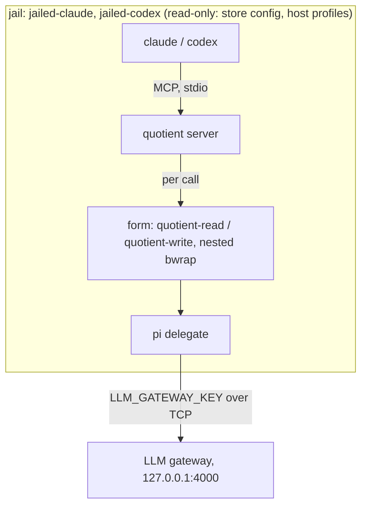

<!-- doctrine:section sec-arrangement -->
## Arrangement and goal

**What changes.** Today a jailed claude or codex delegates only through its
subagents, because `quotient` is not in a jail (DEC-122). This slice puts a real
quotient server in `jailed-claude`, `jailed-codex` and `jailed-shell`. Its
delegates run under the project's existing form family, nested inside the jail.
claude and codex get it registered as an MCP server; the shell carries it
unregistered, as a test bed and for `quotient reduce`. `jailed-pi` and
`jailed-pi-research` do not change.

**Why.** It gives a jailed agent quotient's per-call forms, ceilings and reduced
transcripts for delegation in its own repository, the single-repo route that
DEC-122 point 6 names and quotient:DEC-071 shapes. (quotient:DEC-071 is the
decision in `~/dev/quotient` that in-jail quotient is a jail configuration: no
relay, no new form type.)

**Boundary.** The jail's mounts are the limit of what quotient can reach. The
protection binds delegates, not the orchestrator: the agent can kill its own
server, so this is not an adversarial boundary. The host relay stays the answer
where a control must bind an untrusted agent. The relay is untouched and dormant.

This diagram shows what runs where. Nothing here crosses back to the host except
gateway traffic.



The design has three parts: a change to every form (key source, store binds), a
new jail declaration, and the consumer's wiring.

<!-- doctrine:section sec-code-impact -->
## Code impact

| path | change |
|---|---|
| `agents/quotient-in-jail.nix` (new) | `policy`, `config`, `options`, `registration`, `formStoreBinds`, `etcStoreBinds` |
| `agents/jailed-agents.nix` | `quotientServer` argument, its options and assertions; key expression; `formStoreBinds` in `quotientFormFamily` |
| `agents/jailed-agents-test.nix` | behaviour tests |
| `agents/README.md` | a section for in-jail quotient; the delegation-routes table |
| `README.md` | § Jailed Agents: which jails carry quotient |
| `dev-envs/flake.nix`, `dev-envs/flake.lock` | pin v0.6.1; the declaration on three jails |
| `.doctrine/spec/tech/003/` | § The jail set, § Forms, § Concerns and § Decisions, through a revision: "`quotient` is not on a jail's PATH" stops being true |
| `.doctrine/knowledge/decision/122/` | a note: in-jail roots are limited by the jail's mounts; point 6 delivered; point 7's "no reduce" and the `.mcp.json` consequence hold only for jails without `quotientServer` |

Outside this repo, owed and not code: a quotient backlog item for form-probe's
prebuilt-family mode (DEC-127), and a note on quotient:DEC-071 point 3 (DEC-126).

No change to `agents/quotient-relay.nix`, `features/`, or quotient itself. If
`mkFormFamily` or its check needs a change, this work stops and it is raised in
quotient.

<!-- doctrine:section sec-consumer -->
## The consumer: dev-envs

`dev-envs/flake.nix` moves its quotient pin from v0.6.0 to v0.6.1, matching the
root flake, and states the declaration once:

```nix
quotientServer = {
  package = quotient.packages.${system}.default;
  inherit forms;
};
```

| jail | `quotientServer` | registered |
|---|---|---|
| `jailed-claude` | yes | yes |
| `jailed-codex` | yes | yes |
| `jailed-shell` | yes | no |
| `jailed-pi`, `jailed-pi-research` | no | no |

It is passed per jail, not through the `jail` helper's defaults, because two of
five jails do not take it. No `passthru.devEnv` key is involved, so REQ-026 is
unchanged and a project knows nothing of this.

`forms` is defined after `jails` in the same `let`; Nix's laziness makes that
fine, and nothing is cyclic because forms do not depend on jails.

**Effect on a project.** A project's `.mcp.json` entry for bare `quotient` (satan
has one) now finds a server in those three jails, which reverses DEC-122's
consequence on that point. satan's `pi_report` gets the real reducer in place of
the labelled tail, so `pi-report-test.sh` section 1 runs rather than skips.

Delegates rooted at `/workspace/flakes` get no git: `outerGit`'s guard needs
`${PWD%/*}` to equal `$HOME`, and in a nested form it does not. This affects only a
project whose repository sits above it, so only this repo, and it is accepted.

<!-- doctrine:section sec-declaration -->
## The declaration: `quotientServer` (DEC-123, DEC-126)

`makeJailedAgent` gains one argument. `quotient` keeps meaning the relay.

```nix
# The real quotient in this jail (quotient-in-jail.nix): { package; forms; },
# the server and its form family. Off unless a jail declares it. Refused with
# the relay, without a gateway, and without network: a delegate reaches the
# gateway over TCP with the jail's key.
quotientServer ? null,
```

`inner` adds its options beside the relay's, so after `profileOptions`: bwrap
mounts in argv order, and the config must land on top of the persisted home.

```nix
++ lib.optionals (quotientServer != null) (quotientInJail.options ({inherit name;} // quotientServer))
```

**New file, `agents/quotient-in-jail.nix`.** It takes `{lib, pkgs, combinators}`
and returns `{options; formStoreBinds; etcStoreBinds; policy;}`, as `quotient-relay.nix` does for
the relay. It owns everything about quotient inside a jail.

```nix
policy = forms: {
  schema = "quotient-policy/2";
  mode = "per-call";
  enabled = true;
  roots = ["/workspace"];
  maxima = {requests = 60; context_tokens = 280000; cost_usd = 1.0; wall_clock_s = 900;};
  profiles = {read = "read"; research = "read"; review = "read"; judgement = "read"; write = "write"; implement = "write";};
  forms = {read = "${forms.read}/bin/quotient-read"; write = "${forms.write}/bin/quotient-write";};
  exposure = [];
  transcript_budget_bytes = 4096;
};

# Read-only over ~/.config/quotient, so nothing can plant approvals.json.
# profiles/ is the mount point for the host's directory (DEC-126).
config = forms: pkgs.runCommand "quotient-jail-config" {} ''
  mkdir -p $out/profiles
  cp ${pkgs.writeText "policy.json" (builtins.toJSON (policy forms))} $out/policy.json
'';

options = {name, package, forms}: let
  dir = "$HOME/.config/quotient";
in
  with combinators;
    [
      (add-runtime ''
        RUNTIME_ARGS+=(--ro-bind ${config forms} "${dir}" --ro-bind-try "${dir}/profiles" "${dir}/profiles")
      '')
      (add-pkg-deps [package forms.read forms.write])
    ]
    ++ (registration package).${name} or [];
```

Three facts this relies on:

- **The roots entry must stay `/workspace`.** quotient looks for a project form
  at the longest `roots` entry containing the call's root, when no approval
  applies. With `/workspace` that is `/workspace/.quotient/forms`, which does not
  exist, so the policy's `forms` run. Were the root the project, its host
  `.quotient/forms` link would be found unapproved and refused `form-unapproved`.
  The policy therefore names the same family the link would.
- **`~` is the same string on both sides** (SPEC-003 § The jail set), so one
  `$HOME` names the host's profiles as source and the jail's as destination.
- **The maxima and the profile map copy the host policy's values.** The host
  policy is a dotfile outside `flakes/`, so no flake can read it. They are defaults
  for delegates (quotient:DEC-071 point 3), and a new profile needs a line here.

**Registration** is chosen by the jail's `name`; any other name registers nothing.
jail.nix's `set-argv` replaces the entry's argv, and `noescape` keeps the caller's
arguments last.

```nix
registration = package: let
  bin = "${package}/bin/quotient";
  mcpConfig = pkgs.writeText "quotient-mcp.json" (builtins.toJSON {mcpServers.quotient.command = bin;});
  caller = combinators.noescape ''"$@"'';
in {
  # = is required: --mcp-config is variadic and would swallow what follows.
  claude = [(combinators.set-argv ["--mcp-config=${mcpConfig}" caller])];
  # codex filters an MCP child's env to HOME and PATH unless env_vars names more.
  codex = [(combinators.set-argv [
    "-c" ''mcp_servers.quotient.command="${bin}"''
    "-c" ''mcp_servers.quotient.env_vars=["LLM_GATEWAY_KEY","LLM_GATEWAY_URL"]''
    caller
  ])];
};
```

A sibling run as a subagent (`jailed-claude` inside `jailed-codex`) execs the bare
binary, so it gets no injected registration. It can still find quotient on its
own: `quotient` is on its PATH, and a project's `.mcp.json` entry (satan has one)
or its persisted client configuration can start the server once approved.
Exclusion is not a requirement, because a subagent is trusted as the orchestrator
is, and protection binds delegates only. The depth guard counts `jailed-*`
entrypoints, not quotient's form launches. Recursion still ends at the delegate,
since a form's packages do not include quotient.

Assertions, beside the relay's:

```nix
assert quotientServer == null || !quotient || throw "jailed-${name}: quotientServer and the quotient relay are exclusive";
assert quotientServer == null || gateway != null || throw "jailed-${name}: quotientServer needs gateway: its delegates use the jail's key";
assert quotientServer == null || profiles.${profile}.network || throw "jailed-${name}: quotientServer needs network: delegates reach the gateway over TCP";
```

The last two are this design's addition to DEC-123. Without a gateway a form dies
reading a key file the jail lacks, and offline jails are unproven.

<!-- doctrine:section sec-failure-modes -->
## Failure modes

Following SPEC-003 § Degrade and refuse: an absent layer gives less, a broken
layer fails loudly and names the site.

| condition | what happens | where it shows |
|---|---|---|
| relay and `quotientServer` together | refused | evaluation |
| `quotientServer` without gateway, or offline | refused | evaluation |
| host profiles directory absent | jail launches; `profiles/` empty; quotient refuses the call | the delegate call |
| agent writes under `~/.config/quotient` | `EROFS` | the agent's own error |
| `quotient allow` in a jail | a bare call reports and exits 0; approving fails `EROFS`: the config is read-only, machine forms only | the command |
| project's `.quotient/forms` link in the workspace | ignored: the lookup base is `/workspace` | nothing; the policy names the same family |
| a link planted at `/workspace/.quotient/forms` | refused `form-unapproved` | the delegate call |
| `/etc` link not under the store | not bound; the path behaves as the jail's | the form |
| form rebuilt, host project approval stale | no effect in a jail; refused on the host until `quotient allow` | the host's delegate call |

The profiles bind uses `--ro-bind-try` so that a missing dotfile costs delegation,
not the whole jail: the agent is still useful without it.

<!-- doctrine:section sec-forms -->
## Forms: the key and the store binds (DEC-124, DEC-125)

`quotientFormFamily` changes in two ways. Both apply to every family, machine
and per-project, and neither changes a host form's behaviour unless the server's
environment holds `LLM_GATEWAY_KEY`, which then wins over the key file.

**Key source (DEC-124).** A jail has no key file, only `LLM_GATEWAY_KEY`, which
quotient's `childEnv` passes through to the form's launcher. One expression
serves both places:

```nix
secretEnv = secretEnv // {LLM_GATEWAY_KEY = ''''${LLM_GATEWAY_KEY:-$(< "${gateway.keyFile}")}'';};
```

**Store binds (DEC-125).** jail.nix's network combinator binds
`/etc/{hosts,nsswitch.conf,resolv.conf,ssl}` and follows their store targets with
`nix-store --query --requisites`. A jail has no store database, so that query
fails with "path … is not valid", and the form has dangling links: `curl: (60)`,
no `/etc/hosts`. The form adds what the query would have bound, and nothing else:

```nix
# agents/quotient-in-jail.nix
# `etc-store-binds PATH...`: for each link under the paths, the store path it
# resolves to, as NUL-separated bwrap words. Quotient's check needs the form's
# line plain, so this runs in a runtime arg, as the other runtime binds do.
etcStoreBinds = pkgs.writeShellScript "etc-store-binds" ''
  PATH=${lib.makeBinPath [pkgs.findutils pkgs.coreutils pkgs.gnused]}
  find "$@" -type l -exec readlink -f {} + 2>/dev/null |
    sed -n 's|^\(/nix/store/[^/]*\).*|\1|p' | sort -u |
    while read -r p; do printf '%s\0' --ro-bind-try "$p" "$p"; done
'';

formStoreBinds = c: [
  (c.add-runtime ''
    if [ ! -e /nix/var/nix/db ]; then
      mapfile -d "" -t etc_binds < <(${etcStoreBinds} /etc/hosts /etc/nsswitch.conf /etc/resolv.conf /etc/ssl)
      RUNTIME_ARGS+=("''${etc_binds[@]}")
    fi
  '')
];
```

`quotientFormFamily` appends `formStoreBinds c` after the caller's `options`.
Paths are arguments so a test can point the script at a fixture tree.

The "not valid" lines stay in the form's `stderr.log`. With these binds they name
nothing the form lacks, so they are harmless; suppressing them would mean changing
jail.nix.

Consequence: every form gets a new store path. Machine forms follow at the next
`home-switch`. Each project with approved forms needs `bin/dev-envs-forms` and
`quotient allow` again.

<!-- doctrine:section sec-handover -->
## Handover to planning

The order that matters: the form changes first, since everything nested depends on
them, then the declaration, then the consumer, then proof and records. The real-jail
proofs need the consumer built, so they cannot be earlier.

Open at this point:

- Real quotient started by claude or codex: not yet observed, covered by the
  registration smoke.
- A full delegate call from a logged-in agent, carried as the human verification
  item above. If it fails, the likely sites are registration and client quirks, not
  the forms.
- `claude`'s precedence between `--mcp-config` and a project `.mcp.json` entry of
  the same name (satan). Both start the same binary from PATH or the store, so the
  outcome should not differ; execution confirms it.

Assumption carried: quotient's refusal on a missing profile is a clean per-call
refusal. Execution checks it by launching once with the bind absent.

<!-- doctrine:section sec-verification -->
## Verification

**By test, in `agents/jailed-agents-test.nix`**, using the existing fake bwrap and
launcher probes. They run in `just test`.

- "quotientServer: refused with the relay, without a gateway, offline"
- "quotientServer: policy names /workspace and the family's two forms" (a literal
  oracle against `policy`)
- "quotientServer: config binds after the persisted home, profiles after config"
- "quotientServer: the server and both forms are in the jail's closure"
- "claude registers with --mcp-config=, caller's args last"
- "codex registers with env_vars naming the key and URL, caller's args last"
- "shell and pi register nothing; the default argv is untouched"
- "no quotientServer: launcher unchanged" (the default stays off)
- "form key: env wins; file used when env is unset" (runs the expression)
- "etc-store-binds: emits only store targets of links, deduplicated" (a fixture
  tree of links, through `etcStoreBinds`)

`checks.quotient-forms`, both machine and dev-envs, is the static guard that the
forms' line stays plain words with the new runtime arg.

**By agent, in a real `jailed-shell`, per-project dev-envs family**, output recorded
in slice notes. These repeat the probes on the shipped code, since the spike's
differed. Each runs in the shipped jail's own home, `agent`, which never held the
spike's mounts; quotient and satan arrive through `JAIL_WORKSPACE_DEPS`:

- `scripts/hostile-audit`, `read` and `write`: PASS, delegate attempted the write
- `scripts/form-probe` with its `nix` stand-in: exit 0, 26 top-level PASS rows, 73 in all (DEC-127), in the
  test jail described below
- `read` nested: root `EROFS`; `write` nested: root writable
- direct TLS from a delegate: `http=200`, HTTPS `git ls-remote` works
- `approvals.json` and profile writes refused
- satan `pi-report-test.sh`: section 1 passes, full run captured this time
- `jailed-pi` launches unchanged
- registration smoke, no login needed: `jailed-claude -p "say ok"
  --output-format=stream-json --verbose --max-turns 1` shows `quotient` `connected`,
  source `dynamic`, in its init line: a client-to-server handshake. `mcp list` reads
  stored config only, so it never shows it. `jailed-codex exec
  --skip-git-repo-check "say ok"` starts its MCP children without a login; record
  what it reports for `quotient`. A startup line is the claim here, not a model call

**The form-probe test jail.** form-probe builds its own family from quotient's
`nix/checks`, with a fake pi. That family is not the consumer's, so its store paths
are in no shipped jail, and neither a workspace dep nor the stand-in provides them:
a dep lands at `/workspace/<basename>`, and the stand-in only replays answers. The
fixture is test-only:

1. On the host, in `~/dev/quotient`, capture what form-probe asks `nix`: each
   build's output path in `fp/build/<attr>`, the refusal table in `fp/table`, each
   evaluation in `fp/eval/<name>.{out,status}`.
2. Write `nix-store --query --requisites` of the built paths to `fp/closure`.
3. Launch from a directory named `root` holding `fp/`, with `research/raw/nix`
   first on PATH. The stand-in reads `/workspace/root/fp`.
4. Use a scratch copy of `dev-envs/` whose `jailed-shell` adds one option: a
   read-only bind at its own path for each line of `fp/closure`.

That bind is the only difference from the shipped jail, and it stays out of the
shipped flake. So form-probe proves the builder nested, with the probe family kept
apart from the consumer's. Every other row runs in the unmodified jail.

**By human:** one delegate call from a logged-in `jailed-claude` and one from
`jailed-codex`. So far neither client has started the real server: the client
probes used an environment-dumping stand-in server, and real quotient was driven
directly from Node. The smoke above covers startup; a model call needs a login, so
no agent can prove it from here.

Closure needs all of the above, `just test` and the gate green.

