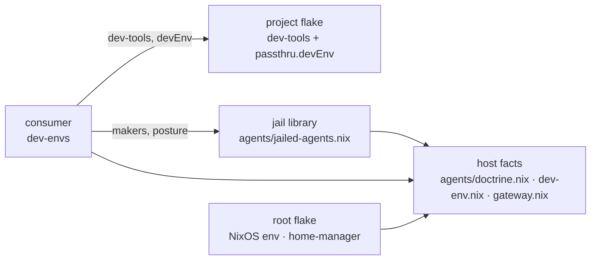

# SPEC-003: Dev-environment contract

<!-- Reference forms: `lib:reference/glossary.md` § reference forms. -->

## Overview

How a project on this host gets its development environment: a shell, jailed
agents and quotient forms, built around the project's own tools. The project
states what it needs and knows nothing about agents. The personal layer decides
how to work and knows nothing about the project.

Four layers. Each fact has one owner (DEC-108), and each arrow points from a
reader to what it reads.



| layer | owns | test for a new item |
|---|---|---|
| host facts | Doctrine's directories, the env list, the gateway's address | true of this host, whatever the project |
| jail library | posture, makers, combinators; applies host facts | true of every jail anyone builds here |
| consumer | the jail set, unjailed CLIs, shorthands, forms, pinned builds | a preference for working on any project |
| project | its tools and what they need | true of the project, whoever works on it |

This spec is the contract between the layers. The jail library's internals are
out of scope (CHR-020); `agents/README.md` is their reference.

## Producer contract

A project joins by exporting one derivation (`dev-envs/flake.nix`, `devTools`):

```nix
packages.<system>.dev-tools = pkgs.buildEnv {
  name = "…-dev-tools";
  paths = […];                       # every tool the project's gate needs
  passthru.devEnv = {                # optional
    env.NAME = "value";              # set as given
    hostEnv = ["OTHER"];             # forwarded from the launch environment when set
    outerGitDir = ".cfg";            # a repository above the project, read-only
  };
};
```

`dev-tools` carries no Doctrine: dev-envs builds its shell, jails and forms from
it, and a jail's `extraPkgs` precede the host install on PATH, so a Nix Doctrine
there would shadow it. A room has no host binary, so a project whose room needs
Doctrine also exports `capsule-tools`, its tool list plus Doctrine, and its fleet
target sets `toolsPackage = "capsule-tools"`. The fleet target changes before
Doctrine leaves `dev-tools` (DEC-112's order). `dev-envs` does not read
`capsule-tools`.

The project may rely on:

- Its tools are built at its own `flake.lock`. The consumer takes the project as
  source (`flake = false`) and evaluates it with flake-compat, because an
  overridden flake input is relocked under the consumer (Lix 2.95.4).
  `checks.project-pins` tests this mechanism with the stub project; it does not
  inspect a real project.
- `env` reaches every jail, every form and the shell. `hostEnv` names reach
  every jail and form, and only when set at launch; the shell inherits them from
  the caller's environment anyway.
- Only tracked files reach the consumer: the project input is `git+file`. The
  exception is a project named with `--project path:…`, where the git toplevel
  is not the project: all of its directory reaches the store.
- `outerGitDir` names a git dir beside the launch directory, whose worktree is
  the launch directory's parent (the home repo: `~/.cfg`, worktree `$HOME`). A
  jail or form launched from the project root sees that repository read-only:
  `status`, `log` and `diff` work, nothing can be staged or committed, and every
  tracked path outside the project reads as deleted. Remotes and branch tracking
  are absent. A launch from a subdirectory finds no repository.

The project owes nothing else. It names no jail, agent, form or gateway.
`_templates/dev-env` is the contract as a working flake.

### `devEnv` schema and refusals

`checkDevEnv` (`dev-envs/dev-env.nix`) evaluates `devEnv` and throws once, naming
`packages.<system>.dev-tools.passthru.devEnv` and listing every error.

| input | result |
|---|---|
| no `devEnv` | `{env = {}; hostEnv = [];}` |
| not an attrset | refused |
| a key other than `env`, `hostEnv`, `outerGitDir` | refused |
| `env` not an attrset, or a value not a string | refused |
| `hostEnv` not a list of strings | refused |
| `outerGitDir` not a bare directory name | refused |
| a name that is not a valid POSIX name | refused |
| a name in `env` or `hostEnv` also in the host's env list | refused: one owner per fact |

The host's env list here means `hostDevEnv.env` and `hostOnlyEnv`: `hostNames`
(`dev-envs/dev-env.nix`) takes both.

## Host facts

Plain data under `agents/`, read by relative path. Nothing copies them.

| fact | owner | readers |
|---|---|---|
| Doctrine's install dir, `.local/share/doctrine/bin` (home-relative) | `agents/doctrine.nix` `installBinDir` | `modules/user-bin-path.nix`, jail library |
| Where a jail sees a Nix-built Doctrine, `/run/doctrine-nix-bin` | `agents/doctrine.nix` `nixBinDir` | jail library |
| The env list and its packages | `agents/dev-env.nix` `for pkgs` → `env`, `packages` | `dev.env` feature, consumer through `hostDevEnv` |
| The host shell's sccache socket | `agents/dev-env.nix` `for pkgs` → `hostOnlyEnv` (Linux) | `dev.env` feature applies it; `checkDevEnv` reads its names |
| The gateway's address and client keys | `agents/gateway.nix` | jail library; SPEC-001 owns the contract |
| Order of user bin directories | `modules/user-bin-path.nix` | pam (Linux), `home.sessionPath` (darwin) |

A variable and the package that makes it work are one fact: whoever applies
`RUSTC_WRAPPER=sccache` also applies sccache. `mold` and its flag are Linux only.

`for` returns `{env; hostOnlyEnv; packages;}`. `env` goes everywhere: host shells,
jails, forms, the consumer's shell. `hostOnlyEnv` goes to host shells and never
to a jail or form.

## What each surface gets

`dev-envs#default` and the forms are built from the same four values: the
project's `dev-tools`, `hostDevEnv`, the validated `devEnv` and `dev-db`. The
consumer is Linux only and holds no keys of its own.

| | jail | form | shell |
|---|---|---|---|
| project's `dev-tools` | yes | yes | yes |
| host list and its packages | yes | yes | yes |
| `dev-db`, a project's throwaway Postgres | yes | yes | yes |
| `quotient-hostile-audit`, the write-denial probe over the linked forms | no | no | yes |
| `devEnv.env` | yes | yes | yes |
| `devEnv.hostEnv` | forwarded | forwarded | inherited |
| `devEnv.outerGitDir` | read-only, at `/workspace` | read-only, at `$HOME` | no: the host's own git |
| posture (`posture` in the library) | yes | yes | none |
| host Doctrine on PATH | yes | yes | from the host PATH |
| Nix Doctrine at `/run/doctrine-nix-bin`, off PATH | yes | yes | no |
| own sccache socket `/tmp/sccache.sock` | yes | yes | no: the host's, from `dev.env` |
| gateway key | yes, key `pi` | yes, key `pi` | no |

`dev-db` (`dev-envs/dev-db.sh`) runs the Postgres in the project's `dev-tools`
on a unix socket under `/tmp/$DEV_DB_NAME/db`. The consumer carries the command
and the project carries the server, so `dev-db` works for a project whose tools
include `postgresql`. Nothing listens on TCP: jails share host loopback, where a
port would collide and trust auth would be open to every jail (RSK-001). In a
jail or form `/tmp` is private, so each has its own cluster. In the shell `/tmp`
is the host's, and the cluster outlives the session.

### The jail set

| jail | agent | profile | subagents | shorthand |
|---|---|---|---|---|
| `jailed-pi` | pi | `specDev` | itself, depth 2 | `jpi` |
| `jailed-pi-research` | pi | `research` | itself | — |
| `jailed-claude` | claude | `specDev` | itself, pi; depth 2 | `jcl` (adds `--dangerously-skip-permissions`) |
| `jailed-codex` | codex | `specDev` | claude, pi, codex | `jcx` |
| `jailed-shell` | zsh | `specDev` | pi, claude | `jsh` |

The set is the same for every project. Profiles are defined in
`agents/README.md` § Profiles. A jail's home is a persisted directory bound over
the host's `$HOME` path, so `~` is the same string on both sides and different
files. The project is bound read-write at `/workspace/<name>`.

A jail delegates through its subagents. `jailed-claude`, `jailed-codex` and
`jailed-shell` also carry the real quotient, declared by `quotientServer`
(DEC-123): it is on their PATH, claude and codex have it registered as an MCP
server, and its delegates run in the project's forms, nested in the jail.
`jailed-pi` and `jailed-pi-research` do not: `quotient` is not on their PATH, so
a project's `.mcp.json` entry for it has no server there.

That server runs under the jail's own read-only policy, not the host's. Its root
is `/workspace`, so the jail's mounts are its limit, and it names its forms, so
nothing needs `quotient allow` in a jail. Profiles are the host's directory,
bound read-only (DEC-126). Its protection binds delegates, not the agent.
`agents/README.md` § In-jail quotient has the mechanics.

No jail in the set carries the quotient relay (DEC-122). The relay is a
capability for a jail declared for cross-repo delegation (IDE-010), and it is
not a `passthru.devEnv` key.

### Doctrine on both sides

The host's install dir is bound read-only at its own path, with its binary's
store closure, and goes on PATH. So one path names Doctrine on both sides, and
what `doctrine install` bakes (`BIN_PATH` in the pi extension, `command` in
codex's config) is valid on both. If Doctrine is not installed, the bind is
skipped and the jail has no `doctrine`. It is the only `doctrine` on PATH because
`dev-tools` carries none.

The Nix Doctrine is a pinned reference build, the consumer's `doctrine` input. It
is mounted but not on PATH: a tool must name it.

### The shell

`use_dev_envs` (`envrc/dev-envs.sh`) enters `dev-envs#default` with the checkout's
toplevel as `project` and the in-tree `agents` library, read-only:

```zsh
source_env_if_exists ~/flakes/envrc/dev-envs.sh
use_dev_envs || use flake .
```

It carries the five jails, the unjailed `pi`, `claude` and `codex`, the
shorthands, the tools and the env. Doctrine's pin in dev-envs' lock is
deliberately not overridden.

### Forms

`quotient-read` and `quotient-write` are what a delegate runs in. `bin/dev-envs-forms`
builds them and links `.quotient/forms/{read,write}`; `.quotient/result-*` are
the GC roots. On the host, approval is the operator's act: `quotient allow`, again
after every form rebuild. With no approval and no link, quotient runs the machine forms. A
link nobody approved, or a rebuilt form under an old approval, is refused
`form-unapproved`; an approved root whose link is gone is refused `form-invalid`,
with no fallback (`quotient help policy` § Project forms).

A form's `~/.cargo` and sccache cache were not present between two observed runs:
treat them as per-run (IMP-059). `cargo --offline` fails in a form.

## Degrade and refuse

An absent layer gives less. A broken layer fails loudly, naming the site (DEC-105).

| condition | outcome | caught by |
|---|---|---|
| non-Linux host, or no git checkout | `use_dev_envs` returns 1; the `.envrc`'s `\|\|` takes the project's own shell | `envrc/dev-envs-test` |
| no helper file | `use_dev_envs` is undefined, so the call fails and the `\|\|` takes the same path | not tested |
| no `devEnv` | host list only | `checkDevEnv` |
| no installed Doctrine | no `doctrine` in the jail | runtime `-try` bind |
| no `dev-tools` | evaluation error naming the producer contract | `dev-envs/flake.nix` |
| malformed `devEnv` | evaluation error listing each problem | `checks.dev-env` |
| a form's line cannot be resolved without running it | build failure | `checks.quotient-forms` |
| the pinned `doctrine` input fails to build | every jail and form fails to build | at the lock bump; roll the pin back |

## Responsibilities

- Own each environment fact in one layer
- Define what a project exports to join
- Validate a project's stated env before anything is built
- Give every jail, form and shell the same tools and env
- Keep one Doctrine path valid on host and in a jail
- Keep the host's sccache server out of reach of jails

## Mechanism

```
project checkout
  └─ git+file ──> dev-envs (project: flake = false)
                    flake-compat ─> dev-tools ─> devEnv ─> checkDevEnv
                    agents.lib.mkJailedAgents ─> hostDevEnv, makers, posture
                    env = hostDevEnv.env // devEnv.env
                        ├─ jails ─> devShells.default
                        └─ quotientFormFamily ─> quotient-{read,write}
```

Both entry points, `use_dev_envs` and `bin/dev-envs-forms`, pass
`--override-input project`, `--override-input agents path:~/flakes/agents` and
`--no-write-lock-file`, so a library edit lands without a push and neither
override reaches dev-envs' lock (DEC-120). `dev-envs/stub-project` is the lock's
stand-in for `project`; its lock pins a nixpkgs that dev-envs does not.

What the checks can detect:

- `checks.dev-env` runs each refusal against the real `hostDevEnv`, so a name the
  host layers own is refused from the list that sets it.
- `checks.stub` finds, in each jail's launcher or the one launcher it execs, the
  bundle's path, a project `env` name and a `hostEnv` forwarding test. It does not
  run a launcher, and it does not cover forms.
- `checks.project-pins` compares the stub's `passthru.nixpkgsRev` with the stub's
  lock, so it shows the consumer keeps a project's lock for one input. `just test`
  runs it against the stub only: no other project carries that attribute, so the
  check does not apply to one, and the contract does not ask for it.
- `checks.quotient-forms` is the only static guard on the forms' bwrap line.
- `jailed-agents-test` greps launchers for the Doctrine binds and the sccache
  socket; it shows the flag is present, not that a server is reached. That `/tmp`
  is private to a jail comes from jail.nix: observed live, not tested here.

Behaviour was verified live once, at SL-023 PHASE-07 (`.doctrine/slice/023/notes.md`
§ PHASE-07 VA-1): a gate run in a jail, sccache hits in a jail and a form, and
codex reaching Doctrine's MCP server on both sides. The operator confirmed pi and
codex on both sides (PHASE-07 VH-1). No test repeats any of this.

## Concerns

- **Shared loopback.** Networked jails share the host's network namespace, so a
  service on host `127.0.0.1` is reachable from them. sccache's server runs the
  compiler, so a shared server would run a jail's build scripts on the host.
  DEC-121 gives each side a unix socket; RSK-001 covers the class, which that does
  not close.
- **Doctrine's dispatch jail is not the library's.** `doctrine:scripts/spawn-confined.sh`
  and `pi-respawn-nofork.sh` confine with `--ro-bind / /` and inherit the env, so
  the host's socket is visible and its address arrives with the env. They set
  `SCCACHE_SERVER_UDS=/tmp/sccache.sock` themselves (RV-047 F-1). The host's address
  is safe only where a jail sets its own, so a new whole-root jail must do the same.
- **A form rebuild needs approval.** Any toolchain change gives a new form
  identity, and the host's quotient refuses delegates until `quotient allow` runs.
- **Doctrine's version skew.** The host install and the Nix Doctrine are separate
  builds; only the host install is on PATH, so a stale install is what agents run.

## Hypotheses

- The jail set is the same for every project. A project needing a different set
  would need a new contract surface; none has so far. A project-local capability
  jail (IDE-010) would be the first.
- A project's tools can be described by one `buildEnv` and a flat env. Smut and
  Doctrine are the two producers tested.

## Decisions

The decisions this spec composes. Read one with `doctrine show DEC-NNN`.

| area | decisions |
|---|---|
| layers, spec | DEC-108, DEC-118 |
| producer, env | DEC-114, DEC-105 |
| consumer, forms | DEC-113, DEC-115, DEC-120 |
| Doctrine paths, PATH | DEC-107, DEC-109, DEC-110, DEC-111, DEC-112 |
| the Mac | DEC-116 |
| sccache | DEC-121 |
| delegation from a jail | DEC-122, DEC-123, DEC-124, DEC-125, DEC-126, DEC-127 |

## Open questions

- Should `checkDevEnv` also refuse names the library sets, such as
  `CLAUDE_CODE_SHELL`? A project's `env` comes later on the bwrap line, so it
  would win (inferred from the order, not run).
- What replaces shared loopback for networked jails (RSK-001)?
- Should write forms keep a cargo home and sccache cache across runs (IMP-059)?
